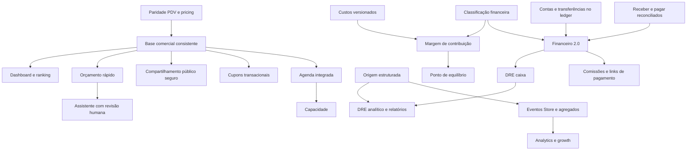

# PrintFlowPRO — benchmark e gap analysis

## 1. Executive Summary

**PRINTFLOWPRO_BENCHMARK_GAP_ANALYSIS=PASS — análise concluída; nenhuma feature implementada.**

Data: 21/10/2026 (America/Bahia). Referência funcional: os 45 blocos das seções 6–50 do pedido autorizado. Cada bloco tem exatamente uma classificação primária; subcapacidades existentes e ausentes são discriminadas dentro dele. Esta matriz passa a ser a base de planejamento, não uma autorização de implementação.

A base atual já oferece agregados comerciais, pricing sofisticado, catálogo configurável, caixa, recebíveis, DRE simplificada e Central WhatsApp. A maior oportunidade é completar e integrar capacidades existentes antes de criar novos módulos. Priorizar integridade entre canais, métricas consistentes, ranking/segmentação e qualidade do catálogo. Agenda, contas bancárias e cupons exigem desenho transacional próprio. IA, billing, fiscal e chat não estão implementados apenas porque existe um toggle ou contato WhatsApp.

**Achado prioritário:** o PDV calcula área diretamente (E3), enquanto o engine aplica piso (E4). Para produto de R$ 70/m², mínimo 0,30 m² e medida real 0,20 m², o caminho atual do PDV implica R$ 14 versus R$ 21 no engine. É evidência estática da fórmula, não uma venda criada/testada nesta auditoria. A validação anterior de metros não deve ser interpretada como prova de paridade completa do PDV com o engine. Planejar uma correção focada antes de ampliar o PDV; nenhuma correção foi realizada aqui.

**Limite do benchmark:** os prints de referência não foram disponibilizados nesta etapa/contexto. A análise cobre integralmente o catálogo textual fornecido, sem inventar telas, funcionalidades ocultas ou afirmar superioridade visual. EXISTS_BETTER_IN_PRINTFLOW compara o escopo funcional textual descrito, com ressalvas expressas. Não houve comparação visual pixel a pixel.

## 2. Estado atual e método

`PRINTFLOW_CURRENT_MAIN_SHA=13e46dc2c9f36aa40be76aa2b37e925247f9a9ef`

Executados git fetch origin, status --short, branch --show-current, rev-parse HEAD/origin/main, rev-list --left-right --count e log -10. Entrada: main limpa, stage vazio, HEAD=origin/main, divergência 0/0. Últimos marcos: PR34 metros, PR33 mínimo/expedição, PR32 dependências, PR31 mutações assíncronas, PR30 autoridade Store. Saída esperada: somente este documento novo não rastreado; main e stage inalterados.

Auditoria estática de páginas, serviços, contratos, rotas, migrations e testes versionados. Não foram executados comandos de escrita no Supabase, nem consultado o banco remoto, nem alterados Vercel/Production. “Schema atual” neste documento significa **schema versionado na main**, não atestado de ausência de drift remoto. Antes de uma implementação com schema, comparar ledger e catálogo remoto em leitura. O schema inicial contém DISABLE RLS, superado por migrations posteriores: não foi tratado como política vigente isoladamente. Testes anteriores são contexto; nenhuma suíte foi executada nesta etapa documental.

Módulos auditados: Dashboard, CRM/Clientes, Orçamentos/PDF, Pedidos, PDV/Caixa, Produtos, Pricing, Produção, Expedição, Financeiro, Estoque/Revenda/Fornecedores, Catálogo/Store/Conta/Privacidade, Configurações/Permissões/Auditoria e WhatsApp. Agenda, relatórios gerais, chat, billing e fiscal foram investigados por inventário e busca de implementação, não presumidos pelo nome.

### Evidências reproduzíveis

| ID | Arquivo/trecho na main | Evidência |
|---|---|---|
| E1 | `src/app/(dashboard)/dashboard/page.tsx:79-122` | Receitas pagas, período, receber e lucro estimado fixo de 42%. |
| E2 | `src/app/(dashboard)/crm/page.tsx:219-230,451-470` | Vínculo por ID ou nome; totais/última compra, sem ranking consolidado. |
| E3 | `src/app/(dashboard)/pos/page.tsx:121-131,280-302` | Fator de área/comprimento próprio, sem piso comercial do engine. |
| E4 | `src/lib/pricing.ts:691-738` | resolveBillableArea e getPriceBreakdown aplicam mínimo por peça. |
| E5 | `src/app/(dashboard)/financial/page.tsx:59-200,338` | Reconciliação, recebíveis virtuais, filtros e DRE simplificada por categoria textual. |
| E6 | `src/app/(dashboard)/pricing/page.tsx:199-230,397-414` | Simulador avançado local de materiais, terceiros, mão de obra e instalação. |
| E7 | `src/lib/dummy-data.ts:238-310` | Galeria e definições de grupos/matriz/tiers, sem formulário genérico. |
| E8 | `src/app/store/page.tsx:495-548` | Busca apenas local/debug; mais vendidos usa orders do contexto. |
| E9 | `src/context/database-context.tsx:308-325,689-721,1315,1667-1797` | Permissões padrão, Store omite leituras privadas, fornecedor e comandos comerciais. |
| E10 | `src/app/(dashboard)/layout.tsx:35-65` | Catálogo herda /settings; controle de navegação não substitui autorização do banco. |
| E11 | `supabase/migrations/20260603000000_schema.sql` | Estrutura inicial de produtos, clientes, financeiro, fornecedores, caixa; NÃO representa sozinho RLS atual. |
| E12 | `supabase/migrations/20260712172000_enable_multitenant_rls.sql` | RLS tenant e herança de tenant dos filhos; políticas posteriores precisam ser consideradas. |
| E13 | `supabase/migrations/20260819130847_phase4b_global_persistence_integrity.sql` | RPCs de persistência/caixa/pagamento e current_user_can_access_path. |
| E14 | `supabase/migrations/20260819155635_global_audit_governance.sql` | Triggers de audit, fornecedor incluído, delta sem PII; deduplicação transacional. |
| E15 | `supabase/migrations/20260820163000_order_production_b2b_integrity.sql` | RPCs de pedido/produção/pagamento/B2B. |
| E16 | `supabase/migrations/20260826203444_fix_quote_approval_order_conversion.sql` | Aprovação/conversão atômica. |
| E17 | `supabase/migrations/20261021145952_store_account_server_authority.sql` | Autoridade server-side de conta Store; complemento de restrição em 20261021150121. |
| E18 | `supabase/migrations/20261021183043_independent_shipping_lifecycle.sql` | Ciclo de expedição independente; preservar na agenda. |
| E19 | `src/lib/pdf/pdf-server-auth.ts:67; src/app/api/pdf/quote/[id]/route.ts` | PDF autenticado não é orçamento público. |
| E20 | `docs/phase4b-global-persistence-audit.md; docs/phase4e-audit-coverage-matrix.md` | Débitos anteriores, cobertura e ressalva histórica de company_default_services. |
| E21 | `src/app/(dashboard)/settings/page.tsx:250-252,597-599` | Toggles IA/NF/SaaS não demonstram implementação. |
| E22 | `src/components/catalog/catalog-admin.tsx; src/components/catalog/catalog-banner-manager.tsx` | Configuração de vitrine, banners e ordenação de banners; não de produtos. |
| E23 | `src/lib/whatsapp/; src/app/api/whatsapp/system-message/` | Central contextual, contratos, autenticação e runtime; não chat. |
| E24 | `src/app/api/ e supabase/migrations/ (inventários completos)` | Ausência de rotas/tabelas específicas de IA, chat, billing, fiscal, cupom e analytics nesta base. |

Buscas negativas cobriram src/app/api, src/lib, páginas, componentes, tipos e CREATE TABLE/ADD COLUMN das migrations. Nomes pesquisados incluíram agenda/calendar, recorrência, subscription/billing, coupon/cupom, rating, tracking/page_view, providers, IA e fiscal. “Não encontrado” é limitado à base versionada; não é declaração sobre serviços externos não conectados ao código.

### Distribuição

| Classificação | Quantidade |
|---|---:|
| EXISTS_COMPLETE | 1 |
| EXISTS_PARTIAL | 16 |
| EXISTS_BETTER_IN_PRINTFLOW | 3 |
| UI_ONLY_GAP | 3 |
| LOGIC_GAP | 4 |
| SCHEMA_GAP | 5 |
| NEW_MODULE | 3 |
| DUPLICATE_RISK | 2 |
| NOT_RECOMMENDED | 2 |
| FUTURE_ADVANCED | 6 |
| **Total** | **45** |

## 3. Matriz completa

IDs B06–B50 correspondem às seções do pedido. Risco: escala 1–5. Prioridade Oxx é ordem recomendada, com dependências e segurança prevalecendo sobre a pontuação. Fase é destino de planejamento, não compromisso de prazo. “Zero” em schema aplica-se ao recorte descrito.

### Matriz resumida obrigatória

| Funcionalidade | Status | PrintFlow atual | Gap | Risco | Fase | Prioridade |
|---|---|---|---|---:|---:|---|
| B6 Dashboard 2.0 | EXISTS_PARTIAL | Recebimentos dia/mês, receber/pagar, atrasos, recentes, gráfico semanal e atalhos existem. | Pedidos do dia e cards configuráveis faltam; lucro usa taxa fixa de 42%, não margem apurada. | 3/5 | 5 | O02 |
| B7 Assistente de orçamentos | NEW_MODULE | Rascunho, itens, pricing e salvamento atômico existem; ai_enabled é somente configuração. | Sem parser de mensagem ou integração IA encontrada. Texto primeiro; imagem/OCR só depois; revisão humana obrigatória. | 5/5 | 5 | O26 |
| B8 Ranking de clientes | EXISTS_PARTIAL | Contagem de pedidos/orçamentos, total vendido e última compra por cliente existem. | Sem ranking/ticket agregado. Vinculação por nome e soma sem excluir cancelados exigem definição; margem depende de custos históricos; aberto/B2B já têm base. | 3/5 | 5 | O03 |
| B9 Segmentação e tags | UI_ONLY_GAP | customers.tags, notes, PF/PJ, informações corporativas e crédito B2B existem. | Editor/filtro de tags e segmentos salvos ausentes; hoje tags são preservadas ou recebem Cliente. | 2/5 | 5 | O04 |
| B10 Orçamento público | SCHEMA_GAP | PDF autenticado, WhatsApp e aprovação atômica existem; não equivalem a permalink público. | Faltam token revogável/expirável, visualização mínima, recusa, pedido de ajuste e eventos de visualização. | 5/5 | 5 | O25 |
| B11 Orçamento rápido | DUPLICATE_RISK | Editor atual já permite cliente, itens, quantidade, preço, salvar/enviar e item manual. | Modo compacto deve reutilizar editor, snapshots e RPC; não criar segunda calculadora. | 2/5 | 5 | O05 |
| B12 Painel operacional de pedidos | EXISTS_PARTIAL | Cards/lista, prazo, atraso, status, total, saldo, pagamentos e filtros operacionais existem. | Faltam grupos vence hoje/no prazo/sem prazo e filtro confiável de origem; tratar data ausente sem inventar prazo. | 3/5 | 5 | O06 |
| B13 PDV 2.0 | LOGIC_GAP | Busca nome/SKU, categorias, consumidor final, carrinho lateral, recebimento e caixa físico existem. | Sem fluxo dedicado de scanner/atalhos/item livre/vendedor; cálculo próprio não aplica resolveBillableArea. Integridade precede UX. | 5/5 | 6 | O01 |
| B14 Composição de custos | EXISTS_PARTIAL | Produto guarda matéria-prima, operação/tempo, perdas, taxas/comissão; simulador avançado tem mão de obra, terceiros e instalação. | Avançado é simulação local; faltam composição persistida/versionada e rateio de fixos; não confundir custo estimado com realizado. | 4/5 | 6 | O12 |
| B15 Preço por quantidade | EXISTS_COMPLETE | volume_pricing e tiers de matriz, mínimos e unitário/total resolvidos no pricing central. | Não criar nova regra de tiers. Integração desigual do PDV está no item 13. | 2/5 | 6 | O43 |
| B16 Variações | EXISTS_PARTIAL | Cor, tamanho, material, acabamento, grupos single/multiple e matriz com tiers existem em Produto/Store. | Auditar paridade de seleção em todos os canais; PDV não oferece configurador completo. Evitar variantes paralelas. | 3/5 | 6 | O15 |
| B17 Campos personalizados | SCHEMA_GAP | Grupos de seleção e dimensões existem; observações são específicas dos fluxos. | Falta contrato genérico texto/número/checkbox/arquivo com validação, obrigatoriedade e snapshot. | 4/5 | 6 | O16 |
| B18 Galeria e vídeo | EXISTS_PARTIAL | Múltiplas imagens, principal, alt e posição em pricing_details.gallery_images existem. | Vídeo por produto/YouTube/visibilidade individual não encontrados; link social YouTube da empresa não é vídeo de produto. | 3/5 | 11 | O34 |
| B19 Agenda operacional | NEW_MODULE | Prazos de Pedido/Produção/Expedição existem; não há agenda de compromissos. | Cliente, responsável, categoria, início/fim, recorrência, lembretes, ocupação, dia/semana/mês e relatórios faltam. | 4/5 | 7 | O27 |
| B20 Precificação orientada | EXISTS_BETTER_IN_PRINTFLOW | Seleção guiada de modelos, m²/linear, tiers/matriz, mínimo comercial, metros e breakdown real já vão além do roteiro genérico. | Faltam onboarding de custos fixos e margens por categoria; preservar engine e limites de cada canal. | 4/5 | 6 | O13 |
| B21 Templates de precificação | UI_ONLY_GAP | Modelos guiados e tipos de serviço visual já existem. | Presets banner/lona, adesivo, fachada, cartão, flyer, etiqueta, sublimação, DTF, MDF e 3D devem preencher campos revisáveis; não inventar preço de mercado. | 2/5 | 6 | O14 |
| B22 Ponto de equilíbrio | LOGIC_GAP | Ledger tem despesas e receitas; pricing tem taxas/margens estimadas. | Faltam custos fixos classificados, contribuição, dias úteis, meta e capacidade. Não usar lucro fixo 42%. | 4/5 | 8 | O21 |
| B23 Impostos e taxas gerenciais | EXISTS_PARTIAL | settings.tax_rate/commission_rate, perdas e custos variáveis no pricing; métodos de pagamento registrados. | Sem regime fiscal operacional ou tabelas de taxas por meio/parcela; separar taxa estimada de desconto efetivo. | 4/5 | 8 | O20 |
| B24 Financeiro — visão geral | EXISTS_PARTIAL | Recebido/pago por período, saldo, receber/pagar, meios e gráfico existem; dashboard tem recebido hoje. | Consolidar semântica entre dashboard e financeiro; método mais usado é derivável; não criar ledger de dashboard. | 3/5 | 8 | O09 |
| B25 Contas bancárias | SCHEMA_GAP | settings.bank_name/PIX e caixa físico não são contas bancárias nem saldos conciliados. | Faltam contas, vínculo aos lançamentos, transferência dupla, ajuste, bloqueio e histórico por conta. | 5/5 | 8 | O17 |
| B26 Fluxo de caixa | EXISTS_PARTIAL | Entrada/saída manual, categoria textual, período, gráfico e saldo existem. | Falta conta bancária e classificação governada; saldo global e resultado do período precisam rótulos distintos. | 4/5 | 8 | O18 |
| B27 Contas a pagar | EXISTS_PARTIAL | Despesas com vencimento, valor, categoria, pago/pendente e parcelamento existem. | Faltam fornecedor ligado, conta, recorrência idempotente e classificação fixo/variável. | 4/5 | 8 | O19 |
| B28 Contas a receber | EXISTS_PARTIAL | Ledger reconciliado, saldo B2B virtual, pendente/parcial/pago em pedidos e baixa atômica existem. | Aging, vencimentos/saúde, filtros consistentes e regras de estorno precisam consolidação. Linha virtual não é nova receita. | 4/5 | 8 | O10 |
| B29 Histórico de pagamentos | EXISTS_PARTIAL | Método, valor, pedido, descrição, cliente por relação e filtros existem; recibo PDF autenticado. | Faltam extrato dedicado e trilha clara de ajuste/estorno; descrição não é campo livre ilimitado de dados pessoais. | 4/5 | 8 | O11 |
| B30 Links de pagamento | FUTURE_ADVANCED | PIX gerado localmente e meios de pagamento não comprovam provider integrado; sem webhook financeiro encontrado. | Definir provider, checkout, status, expiração, assinatura de webhook e idempotência antes de link. | 5/5 | 11 | O36 |
| B31 Comissões | FUTURE_ADVANCED | commission_rate é componente estimado de preço, não passivo por vendedor. | Faltam regras versionadas, vendedor, fechamento, aprovação, pagamento, extrato e reversões. | 5/5 | 11 | O37 |
| B32 DRE caixa e competência | EXISTS_PARTIAL | Tela DRE Simplificada calcula receita, custos diretos por texto da categoria e despesas operacionais. | Formalizar DRE caixa primeiro; classificação textual é frágil. Competência exige política de reconhecimento, não mera troca de data. | 4/5 | 9 | O22 |
| B33 DRE analítico | LOGIC_GAP | Pedido→cliente e itens→produto/categoria permitem parte do detalhamento. | Conta e canal estruturados faltam; despesas não têm atribuição a produto/cliente; rateios podem duplicar valores. | 5/5 | 9 | O24 |
| B34 Relatórios | EXISTS_PARTIAL | Telas com filtros/gráficos, PDFs comerciais e CSV de auditoria existem. | Sem framework comum de relatórios Financeiro/Vendas/Produtos/Clientes, colunas e exportações governadas. | 3/5 | 9 | O23 |
| B35 Dashboard do catálogo | SCHEMA_GAP | Store tem pedidos/interesses relacionados; consentimentos analytics existem. | Sem coleta persistente de sessões/page views/cliques/carrinho/checkout e funil encontrada. Receita/ticket dependem de origem confiável. | 4/5 | 10 | O30 |
| B36 Qualidade do catálogo | UI_ONLY_GAP | Imagem, descrição, categoria, estoque, preço, prazo, slug e ativo já são consultáveis. | Checklist derivado; estoque só se controlado e preço sob consulta não é erro; validar permalink pelo resolver, não apenas string. | 2/5 | 10 | O07 |
| B37 Top produtos e buscas | LOGIC_GAP | Mais vendidos deriva de orders presentes no contexto; busca pública é filtro local e debug console. | No público dados privados são omitidos: ranking pode cair no alfabético. Agregado público sanitizado e coleta de buscas faltam. | 4/5 | 10 | O29 |
| B38 Personalização da vitrine | EXISTS_BETTER_IN_PRINTFLOW | Identidade, cores, logo, WhatsApp, domínio, rodapé/social, sete benefícios, banners responsivos e mega menu existem. | Mais amplo que a lista textual de personalização; não há prova de superioridade visual sobre prints ausentes. Templates de layout não encontrados. | 2/5 | 10 | O44 |
| B39 Ordem de produtos | SCHEMA_GAP | Visibilidade/destaque de produtos existem; sort_order é de banner/categoria/matriz, não ordenação geral do produto. | Faltam posição editorial de produto e drag-and-drop com persistência/concorrência. | 3/5 | 10 | O31 |
| B40 Pedidos do catálogo | DUPLICATE_RISK | Store, quote e order usam agregados existentes; source_quote_id e metadados/notes ajudam rastreamento. | Criar filtro/read-model com origem estruturada e confiável; não outro sistema de Pedido. | 3/5 | 10 | O28 |
| B41 Marketing do catálogo | EXISTS_PARTIAL | Barra informativa, banners, destinos, promoções e cores existem. | Contador real, campanhas com vigência e cupom não encontrados; não usar urgência artificial. | 3/5 | 10 | O32 |
| B42 Cupons | NEW_MODULE | Desconto comercial em quotes/orders existe; não há motor de cupom. | Faltam código, tipo, validade, mínimo, escopo produto/categoria, limites e consumo concorrente tenant. | 5/5 | 10 | O33 |
| B43 Prova social por popup | NOT_RECOMMENDED | Pedidos não são feed público; não há base específica encontrada. | Não priorizar popup com nomes reais; se houver valor demonstrado, agregados anônimos e revisão de privacidade. Nunca fabricar compra. | 5/5 | 11 | O41 |
| B44 Avaliações | FUTURE_ADVANCED | Produto e pedido permitem verificar compra; rating/moderação não encontrados. | Faltam elegibilidade, comentário, denúncia/moderação, anonimização e controle de abuso. | 4/5 | 11 | O35 |
| B45 Stories | NOT_RECOMMENDED | Banners e galeria já atendem mídia comercial. | Sem evidência de valor incremental; adiar até medir conversão e demanda. Evitar novo sistema de mídia. | 3/5 | 11 | O42 |
| B46 WhatsApp | EXISTS_BETTER_IN_PRINTFLOW | Central, mensagens personalizadas, variáveis contextuais server-side, preview, audit e runtime 6/6 existentes. | Preservar resolução canônica. Não confundir abrir WhatsApp com mensageria bidirecional ou entrega comprovada. | 3/5 | 5 | O45 |
| B47 Chat da loja | FUTURE_ADVANCED | Contato WhatsApp existe; não há módulo de conversas/realtime visitante-operador encontrado. | Conversa, visitante, operador, anexos, notificações, vínculo de pedido e retenção exigem projeto próprio. | 5/5 | 11 | O40 |
| B48 Assinatura SaaS | FUTURE_ADVANCED | companies/profiles e toggle saas_enabled existem. | Sem planos, billing, expiração, histórico, limites e entitlements efetivos encontrados; estratégia comercial precisa ser definida. | 5/5 | 11 | O38 |
| B49 Notas fiscais | FUTURE_ADVANCED | Toggle nfe_enabled não é emissão fiscal. | Sem provider, NFS-e/NF-e, certificado, município ou autorização fiscal encontrados. Descoberta especializada antes de estimar entrega. | 5/5 | 11 | O39 |
| B50 Fornecedores | EXISTS_PARTIAL | Tabela suppliers e addSupplier no contexto; Revenda lê terceirização de order_items. | Sem CRUD UI completo, atualização/arquivamento, compra formal e vínculo financeiro; débito documentado na Fase 4B. | 3/5 | 8 | O08 |

### Fichas técnicas — campos completos por funcionalidade

Todos os perfis de acesso abaixo são contexto atual + proposta para a evolução. Não se presume que permitir uma rota na UI concede automaticamente uma capacidade no banco. Reutilizar RLS e RPC com validação de ator/tenant/objeto, e testar cada caminho novo.

#### B6 — Dashboard 2.0

| Campo | Auditoria / proposta |
|---|---|
| Funcionalidade | Dashboard 2.0 |
| Módulo destino | Dashboard |
| Status atual | **EXISTS_PARTIAL** — Recebimentos dia/mês, receber/pagar, atrasos, recentes, gráfico semanal e atalhos existem. |
| Arquivos atuais | `src/app/(dashboard)/dashboard/page.tsx`; contexto compartilhado em `src/context/database-context.tsx` |
| Tabelas atuais | orders, order_items, financial_transactions, customers, quotes |
| RPCs atuais | Nenhuma RPC específica de métricas; leitura pelo DatabaseProvider. |
| Permissões | /dashboard; restringir indicadores financeiros conforme função, não apenas acesso à página. |
| Audit Log | Leitura não gera auditoria; mudança de meta/configuração deverá gerar. |
| Tenant | company_id derivado do perfil ativo; itens herdam tenant do agregado. Joins e novos comandos devem impedir referência cruzada entre tenants. |
| Dependências | financial; complementar grafo da seção 7. |
| Impacto em schema | Sem schema para indicadores; preferências por usuário se cards persistidos. |
| Impacto em UI | Pedidos do dia e cards configuráveis faltam; lucro usa taxa fixa de 42%, não margem apurada. |
| Impacto em regras comerciais | Não alterar preço/status por apresentação. Novos critérios e efeitos precisam de contrato explícito e histórico preservado. |
| Risco | 3/5 — mudança incremental; atenção à autorização e consistência de dados |
| Ordem recomendada | O02 |
| Fase sugerida | 5 |
| Observações | Proposta de planejamento, não implementação nem autorização de mudança. |

#### B7 — Assistente de orçamentos

| Campo | Auditoria / proposta |
|---|---|
| Funcionalidade | Assistente de orçamentos |
| Módulo destino | Orçamentos |
| Status atual | **NEW_MODULE** — Rascunho, itens, pricing e salvamento atômico existem; ai_enabled é somente configuração. |
| Arquivos atuais | `src/app/(dashboard)/quotes/page.tsx`; contexto compartilhado em `src/context/database-context.tsx` |
| Tabelas atuais | quotes, quote_items, customers, products |
| RPCs atuais | save_quote_with_items_phase4b; approve_quote_and_create_order. |
| Permissões | /quotes; aprovação pública exigirá autoridade limitada por token, não papel administrativo. |
| Audit Log | quote.* existente; proposta: draft_assisted, share_created/revoked, response_received sem texto bruto. |
| Tenant | company_id derivado do perfil ativo; itens herdam tenant do agregado. Joins e novos comandos devem impedir referência cruzada entre tenants. |
| Dependências | products, pricing; complementar grafo da seção 7. |
| Impacto em schema | S1: execuções opcionais e proveniência; rascunho usa quotes existentes. |
| Impacto em UI | Sem parser de mensagem ou integração IA encontrada. Texto primeiro; imagem/OCR só depois; revisão humana obrigatória. |
| Impacto em regras comerciais | Manter quote/order únicos, revisão humana, aprovação atômica e preço recalculado em fonte confiável; não converter automaticamente texto/evento em venda. |
| Risco | 5/5 — integridade, privacidade ou integração exige validação dedicada |
| Ordem recomendada | O26 |
| Fase sugerida | 5 |
| Observações | Proposta de planejamento, não implementação nem autorização de mudança. |

#### B8 — Ranking de clientes

| Campo | Auditoria / proposta |
|---|---|
| Funcionalidade | Ranking de clientes |
| Módulo destino | Clientes |
| Status atual | **EXISTS_PARTIAL** — Contagem de pedidos/orçamentos, total vendido e última compra por cliente existem. |
| Arquivos atuais | `src/app/(dashboard)/crm/page.tsx`; contexto compartilhado em `src/context/database-context.tsx` |
| Tabelas atuais | customers, orders, quotes |
| RPCs atuais | CRUD via insertTenantRecord/patchTenantRecord/deleteTenantRecord; sem RPC de ranking. |
| Permissões | /crm; dados financeiros só para funções autorizadas; tags alteráveis por vendas/gerência conforme política. |
| Audit Log | customer.* via governança existente; futuro segmento/tag deve registrar alteração sem copiar notas/PII. |
| Tenant | company_id derivado do perfil ativo; itens herdam tenant do agregado. Joins e novos comandos devem impedir referência cruzada entre tenants. |
| Dependências | orders, financial; complementar grafo da seção 7. |
| Impacto em schema | Sem novas tabelas no MVP; agregação autorizada por customer_id. |
| Impacto em UI | Sem ranking/ticket agregado. Vinculação por nome e soma sem excluir cancelados exigem definição; margem depende de custos históricos; aberto/B2B já têm base. |
| Impacto em regras comerciais | Não alterar preço/status por apresentação. Novos critérios e efeitos precisam de contrato explícito e histórico preservado. |
| Risco | 3/5 — mudança incremental; atenção à autorização e consistência de dados |
| Ordem recomendada | O03 |
| Fase sugerida | 5 |
| Observações | Proposta de planejamento, não implementação nem autorização de mudança. |

#### B9 — Segmentação e tags

| Campo | Auditoria / proposta |
|---|---|
| Funcionalidade | Segmentação e tags |
| Módulo destino | Clientes |
| Status atual | **UI_ONLY_GAP** — customers.tags, notes, PF/PJ, informações corporativas e crédito B2B existem. |
| Arquivos atuais | `src/app/(dashboard)/crm/page.tsx`; contexto compartilhado em `src/context/database-context.tsx` |
| Tabelas atuais | customers, orders, quotes |
| RPCs atuais | CRUD via insertTenantRecord/patchTenantRecord/deleteTenantRecord; sem RPC de ranking. |
| Permissões | /crm; dados financeiros só para funções autorizadas; tags alteráveis por vendas/gerência conforme política. |
| Audit Log | customer.* via governança existente; futuro segmento/tag deve registrar alteração sem copiar notas/PII. |
| Tenant | company_id derivado do perfil ativo; itens herdam tenant do agregado. Joins e novos comandos devem impedir referência cruzada entre tenants. |
| Dependências | orders, financial; complementar grafo da seção 7. |
| Impacto em schema | Zero no MVP; catálogo formal de tags só se governança justificar. |
| Impacto em UI | Editor/filtro de tags e segmentos salvos ausentes; hoje tags são preservadas ou recebem Cliente. |
| Impacto em regras comerciais | Não alterar preço/status por apresentação. Novos critérios e efeitos precisam de contrato explícito e histórico preservado. |
| Risco | 2/5 — mudança incremental; atenção à autorização e consistência de dados |
| Ordem recomendada | O04 |
| Fase sugerida | 5 |
| Observações | Proposta de planejamento, não implementação nem autorização de mudança. |

#### B10 — Orçamento público

| Campo | Auditoria / proposta |
|---|---|
| Funcionalidade | Orçamento público |
| Módulo destino | Orçamentos |
| Status atual | **SCHEMA_GAP** — PDF autenticado, WhatsApp e aprovação atômica existem; não equivalem a permalink público. |
| Arquivos atuais | `src/app/(dashboard)/quotes/page.tsx`; contexto compartilhado em `src/context/database-context.tsx` |
| Tabelas atuais | quotes, quote_items, customers, products |
| RPCs atuais | save_quote_with_items_phase4b; approve_quote_and_create_order. |
| Permissões | /quotes; aprovação pública exigirá autoridade limitada por token, não papel administrativo. |
| Audit Log | quote.* existente; proposta: draft_assisted, share_created/revoked, response_received sem texto bruto. |
| Tenant | company_id derivado do perfil ativo; itens herdam tenant do agregado. Joins e novos comandos devem impedir referência cruzada entre tenants. |
| Dependências | products, pricing; complementar grafo da seção 7. |
| Impacto em schema | S2: quote_share_links e quote_response_events; nunca tornar quotes anônima. |
| Impacto em UI | Faltam token revogável/expirável, visualização mínima, recusa, pedido de ajuste e eventos de visualização. |
| Impacto em regras comerciais | Manter quote/order únicos, revisão humana, aprovação atômica e preço recalculado em fonte confiável; não converter automaticamente texto/evento em venda. |
| Risco | 5/5 — integridade, privacidade ou integração exige validação dedicada |
| Ordem recomendada | O25 |
| Fase sugerida | 5 |
| Observações | Proposta de planejamento, não implementação nem autorização de mudança. |

#### B11 — Orçamento rápido

| Campo | Auditoria / proposta |
|---|---|
| Funcionalidade | Orçamento rápido |
| Módulo destino | Orçamentos |
| Status atual | **DUPLICATE_RISK** — Editor atual já permite cliente, itens, quantidade, preço, salvar/enviar e item manual. |
| Arquivos atuais | `src/app/(dashboard)/quotes/page.tsx`; contexto compartilhado em `src/context/database-context.tsx` |
| Tabelas atuais | quotes, quote_items, customers, products |
| RPCs atuais | save_quote_with_items_phase4b; approve_quote_and_create_order. |
| Permissões | /quotes; aprovação pública exigirá autoridade limitada por token, não papel administrativo. |
| Audit Log | quote.* existente; proposta: draft_assisted, share_created/revoked, response_received sem texto bruto. |
| Tenant | company_id derivado do perfil ativo; itens herdam tenant do agregado. Joins e novos comandos devem impedir referência cruzada entre tenants. |
| Dependências | products, pricing; complementar grafo da seção 7. |
| Impacto em schema | Zero; preferência de modo opcional. |
| Impacto em UI | Modo compacto deve reutilizar editor, snapshots e RPC; não criar segunda calculadora. |
| Impacto em regras comerciais | Manter quote/order únicos, revisão humana, aprovação atômica e preço recalculado em fonte confiável; não converter automaticamente texto/evento em venda. |
| Risco | 2/5 — mudança incremental; atenção à autorização e consistência de dados |
| Ordem recomendada | O05 |
| Fase sugerida | 5 |
| Observações | Proposta de planejamento, não implementação nem autorização de mudança. |

#### B12 — Painel operacional de pedidos

| Campo | Auditoria / proposta |
|---|---|
| Funcionalidade | Painel operacional de pedidos |
| Módulo destino | Pedidos |
| Status atual | **EXISTS_PARTIAL** — Cards/lista, prazo, atraso, status, total, saldo, pagamentos e filtros operacionais existem. |
| Arquivos atuais | `src/app/(dashboard)/orders/page.tsx`; contexto compartilhado em `src/context/database-context.tsx` |
| Tabelas atuais | orders, order_items, quotes, production_queue, shipments, financial_transactions |
| RPCs atuais | save_order_with_items_and_production; transition_order_status_and_production; record_order_payment_and_production. |
| Permissões | /orders; operação financeira exige /financial ou /pos conforme comando existente. |
| Audit Log | order.* e pagamento/produção/expedição existentes; origem só auditada ao mudar materialmente. |
| Tenant | company_id derivado do perfil ativo; itens herdam tenant do agregado. Joins e novos comandos devem impedir referência cruzada entre tenants. |
| Dependências | quotes, financial; complementar grafo da seção 7. |
| Impacto em schema | Zero para grupos; origem estruturada é S3. |
| Impacto em UI | Faltam grupos vence hoje/no prazo/sem prazo e filtro confiável de origem; tratar data ausente sem inventar prazo. |
| Impacto em regras comerciais | Não alterar preço/status por apresentação. Novos critérios e efeitos precisam de contrato explícito e histórico preservado. |
| Risco | 3/5 — mudança incremental; atenção à autorização e consistência de dados |
| Ordem recomendada | O06 |
| Fase sugerida | 5 |
| Observações | Proposta de planejamento, não implementação nem autorização de mudança. |

#### B13 — PDV 2.0

| Campo | Auditoria / proposta |
|---|---|
| Funcionalidade | PDV 2.0 |
| Módulo destino | PDV |
| Status atual | **LOGIC_GAP** — Busca nome/SKU, categorias, consumidor final, carrinho lateral, recebimento e caixa físico existem. |
| Arquivos atuais | `src/app/(dashboard)/pos/page.tsx`; contexto compartilhado em `src/context/database-context.tsx` |
| Tabelas atuais | products, customers, orders, order_items, cash_register_sessions, cash_register_transactions, financial_transactions |
| RPCs atuais | operate_cash_register; criação/pagamento via contexto e RPCs de pedidos. |
| Permissões | /pos; abertura/fechamento/sangria e vendedor devem ser validados no servidor. |
| Audit Log | cash_register.* e order/payment existentes; preservar eventos transacionais. |
| Tenant | company_id derivado do perfil ativo; itens herdam tenant do agregado. Joins e novos comandos devem impedir referência cruzada entre tenants. |
| Dependências | pricing, orders, financial; complementar grafo da seção 7. |
| Impacto em schema | Zero para pricing/scanner; vendedor explícito requer coluna validada, não inferir do operador. |
| Impacto em UI | Sem fluxo dedicado de scanner/atalhos/item livre/vendedor; cálculo próprio não aplica resolveBillableArea. Integridade precede UX. |
| Impacto em regras comerciais | Reutilizar resolveProductPrice, metros, área real/cobrável e snapshots; toda alteração deve provar equivalência entre canais. |
| Risco | 5/5 — integridade, privacidade ou integração exige validação dedicada |
| Ordem recomendada | O01 |
| Fase sugerida | 6 — gate de integridade antecipado antes da Fase 5 |
| Observações | Proposta de planejamento, não implementação nem autorização de mudança. |

#### B14 — Composição de custos

| Campo | Auditoria / proposta |
|---|---|
| Funcionalidade | Composição de custos |
| Módulo destino | Precificação |
| Status atual | **EXISTS_PARTIAL** — Produto guarda matéria-prima, operação/tempo, perdas, taxas/comissão; simulador avançado tem mão de obra, terceiros e instalação. |
| Arquivos atuais | `src/app/(dashboard)/pricing/page.tsx`; `src/lib/pricing.ts`; `src/lib/metric.mjs`; contexto compartilhado em `src/context/database-context.tsx` |
| Tabelas atuais | products.pricing_details, settings, categories, order_items.details, quote_items.details |
| RPCs atuais | Sem RPC de cálculo; persistência do produto via helpers e dos itens via RPC do agregado. |
| Permissões | /pricing e /products; custo/margem não devem aparecer em projeção pública. |
| Audit Log | Simulação sem log; cadastro de produto e alteração de regras seguem product/settings.*. |
| Tenant | company_id derivado do perfil ativo; itens herdam tenant do agregado. Joins e novos comandos devem impedir referência cruzada entre tenants. |
| Dependências | products, financial; complementar grafo da seção 7. |
| Impacto em schema | S4: cost_profiles/product_cost_components opcionais; snapshot versionado. |
| Impacto em UI | Avançado é simulação local; faltam composição persistida/versionada e rateio de fixos; não confundir custo estimado com realizado. |
| Impacto em regras comerciais | Reutilizar resolveProductPrice, metros, área real/cobrável e snapshots; toda alteração deve provar equivalência entre canais. |
| Risco | 4/5 — integridade, privacidade ou integração exige validação dedicada |
| Ordem recomendada | O12 |
| Fase sugerida | 6 |
| Observações | Proposta de planejamento, não implementação nem autorização de mudança. |

#### B15 — Preço por quantidade

| Campo | Auditoria / proposta |
|---|---|
| Funcionalidade | Preço por quantidade |
| Módulo destino | Produtos |
| Status atual | **EXISTS_COMPLETE** — volume_pricing e tiers de matriz, mínimos e unitário/total resolvidos no pricing central. |
| Arquivos atuais | `src/app/(dashboard)/products/page.tsx`; `src/components/store/ProductConfiguratorModal.tsx`; `src/lib/pricing.ts`; `src/lib/dummy-data.ts`; contexto compartilhado em `src/context/database-context.tsx` |
| Tabelas atuais | products (pricing_details, volume_pricing, variant_options, color_options), categories |
| RPCs atuais | CRUD pelos helpers de persistência; resolução de preço é função TS, não RPC. |
| Permissões | /products; configuração pública somente projeção autorizada; mutações não devem confiar no browser. |
| Audit Log | product.* existente; futuras definições/custos/versionamento geram evento material. |
| Tenant | company_id derivado do perfil ativo; itens herdam tenant do agregado. Joins e novos comandos devem impedir referência cruzada entre tenants. |
| Dependências | pricing; complementar grafo da seção 7. |
| Impacto em schema | Zero para capacidade existente. |
| Impacto em UI | Não criar nova regra de tiers. Integração desigual do PDV está no item 13. |
| Impacto em regras comerciais | Reutilizar resolveProductPrice, metros, área real/cobrável e snapshots; toda alteração deve provar equivalência entre canais. |
| Risco | 2/5 — mudança incremental; atenção à autorização e consistência de dados |
| Ordem recomendada | O43 |
| Fase sugerida | 6 |
| Observações | Preservar e testar, sem projeto de reimplementação. |

#### B16 — Variações

| Campo | Auditoria / proposta |
|---|---|
| Funcionalidade | Variações |
| Módulo destino | Produtos |
| Status atual | **EXISTS_PARTIAL** — Cor, tamanho, material, acabamento, grupos single/multiple e matriz com tiers existem em Produto/Store. |
| Arquivos atuais | `src/app/(dashboard)/products/page.tsx`; `src/components/store/ProductConfiguratorModal.tsx`; `src/lib/pricing.ts`; `src/lib/dummy-data.ts`; contexto compartilhado em `src/context/database-context.tsx` |
| Tabelas atuais | products (pricing_details, volume_pricing, variant_options, color_options), categories |
| RPCs atuais | CRUD pelos helpers de persistência; resolução de preço é função TS, não RPC. |
| Permissões | /products; configuração pública somente projeção autorizada; mutações não devem confiar no browser. |
| Audit Log | product.* existente; futuras definições/custos/versionamento geram evento material. |
| Tenant | company_id derivado do perfil ativo; itens herdam tenant do agregado. Joins e novos comandos devem impedir referência cruzada entre tenants. |
| Dependências | pricing; complementar grafo da seção 7. |
| Impacto em schema | Zero para paridade básica; estoque por variante exigiria desenho separado. |
| Impacto em UI | Auditar paridade de seleção em todos os canais; PDV não oferece configurador completo. Evitar variantes paralelas. |
| Impacto em regras comerciais | Reutilizar resolveProductPrice, metros, área real/cobrável e snapshots; toda alteração deve provar equivalência entre canais. |
| Risco | 3/5 — mudança incremental; atenção à autorização e consistência de dados |
| Ordem recomendada | O15 |
| Fase sugerida | 6 |
| Observações | Proposta de planejamento, não implementação nem autorização de mudança. |

#### B17 — Campos personalizados

| Campo | Auditoria / proposta |
|---|---|
| Funcionalidade | Campos personalizados |
| Módulo destino | Produtos |
| Status atual | **SCHEMA_GAP** — Grupos de seleção e dimensões existem; observações são específicas dos fluxos. |
| Arquivos atuais | `src/app/(dashboard)/products/page.tsx`; `src/components/store/ProductConfiguratorModal.tsx`; `src/lib/pricing.ts`; `src/lib/dummy-data.ts`; contexto compartilhado em `src/context/database-context.tsx` |
| Tabelas atuais | products (pricing_details, volume_pricing, variant_options, color_options), categories |
| RPCs atuais | CRUD pelos helpers de persistência; resolução de preço é função TS, não RPC. |
| Permissões | /products; configuração pública somente projeção autorizada; mutações não devem confiar no browser. |
| Audit Log | product.* existente; futuras definições/custos/versionamento geram evento material. |
| Tenant | company_id derivado do perfil ativo; itens herdam tenant do agregado. Joins e novos comandos devem impedir referência cruzada entre tenants. |
| Dependências | pricing; complementar grafo da seção 7. |
| Impacto em schema | S5: definições versionadas em JSON ou tabelas; anexos privados com vínculo tenant. |
| Impacto em UI | Falta contrato genérico texto/número/checkbox/arquivo com validação, obrigatoriedade e snapshot. |
| Impacto em regras comerciais | Reutilizar resolveProductPrice, metros, área real/cobrável e snapshots; toda alteração deve provar equivalência entre canais. |
| Risco | 4/5 — integridade, privacidade ou integração exige validação dedicada |
| Ordem recomendada | O16 |
| Fase sugerida | 6 |
| Observações | Proposta de planejamento, não implementação nem autorização de mudança. |

#### B18 — Galeria e vídeo

| Campo | Auditoria / proposta |
|---|---|
| Funcionalidade | Galeria e vídeo |
| Módulo destino | Produtos |
| Status atual | **EXISTS_PARTIAL** — Múltiplas imagens, principal, alt e posição em pricing_details.gallery_images existem. |
| Arquivos atuais | `src/app/(dashboard)/products/page.tsx`; `src/components/store/ProductConfiguratorModal.tsx`; `src/lib/pricing.ts`; `src/lib/dummy-data.ts`; contexto compartilhado em `src/context/database-context.tsx` |
| Tabelas atuais | products (pricing_details, volume_pricing, variant_options, color_options), categories |
| RPCs atuais | CRUD pelos helpers de persistência; resolução de preço é função TS, não RPC. |
| Permissões | /products; configuração pública somente projeção autorizada; mutações não devem confiar no browser. |
| Audit Log | product.* existente; futuras definições/custos/versionamento geram evento material. |
| Tenant | company_id derivado do perfil ativo; itens herdam tenant do agregado. Joins e novos comandos devem impedir referência cruzada entre tenants. |
| Dependências | pricing; complementar grafo da seção 7. |
| Impacto em schema | JSON aditivo de mídia apenas após validar demanda; não duplicar galeria. |
| Impacto em UI | Vídeo por produto/YouTube/visibilidade individual não encontrados; link social YouTube da empresa não é vídeo de produto. |
| Impacto em regras comerciais | Não alterar preço/status por apresentação. Novos critérios e efeitos precisam de contrato explícito e histórico preservado. |
| Risco | 3/5 — mudança incremental; atenção à autorização e consistência de dados |
| Ordem recomendada | O34 |
| Fase sugerida | 11 |
| Observações | Proposta de planejamento, não implementação nem autorização de mudança. |

#### B19 — Agenda operacional

| Campo | Auditoria / proposta |
|---|---|
| Funcionalidade | Agenda operacional |
| Módulo destino | Agenda proposta |
| Status atual | **NEW_MODULE** — Prazos de Pedido/Produção/Expedição existem; não há agenda de compromissos. |
| Arquivos atuais | `src/app/(dashboard)/production/page.tsx`; `src/app/(dashboard)/shipment/page.tsx`; `src/lib/production/production-service.ts`; contexto compartilhado em `src/context/database-context.tsx` |
| Tabelas atuais | Base: orders.deadline, production_queue, shipments, profiles; appointments ainda inexistente. |
| RPCs atuais | transition_production_stage/transition_shipment existentes; nenhuma RPC de agenda encontrada. |
| Permissões | Proposta /agenda; equipe lê agenda atribuída, gerência redistribui; dados financeiros não propagados. |
| Audit Log | Proposta appointment.created/updated/cancelled/reassigned; lembrete operacional em fila própria. |
| Tenant | company_id derivado do perfil ativo; itens herdam tenant do agregado. Joins e novos comandos devem impedir referência cruzada entre tenants. |
| Dependências | orders, production, shipment; complementar grafo da seção 7. |
| Impacto em schema | S6: appointments/resources/reminder_jobs; prazos existentes projetados, não copiados como fonte concorrente. |
| Impacto em UI | Cliente, responsável, categoria, início/fim, recorrência, lembretes, ocupação, dia/semana/mês e relatórios faltam. |
| Impacto em regras comerciais | Não alterar preço/status por apresentação. Novos critérios e efeitos precisam de contrato explícito e histórico preservado. |
| Risco | 4/5 — integridade, privacidade ou integração exige validação dedicada |
| Ordem recomendada | O27 |
| Fase sugerida | 7 |
| Observações | Proposta de planejamento, não implementação nem autorização de mudança. |

#### B20 — Precificação orientada

| Campo | Auditoria / proposta |
|---|---|
| Funcionalidade | Precificação orientada |
| Módulo destino | Precificação |
| Status atual | **EXISTS_BETTER_IN_PRINTFLOW** — Seleção guiada de modelos, m²/linear, tiers/matriz, mínimo comercial, metros e breakdown real já vão além do roteiro genérico. |
| Arquivos atuais | `src/app/(dashboard)/pricing/page.tsx`; `src/lib/pricing.ts`; `src/lib/metric.mjs`; contexto compartilhado em `src/context/database-context.tsx` |
| Tabelas atuais | products.pricing_details, settings, categories, order_items.details, quote_items.details |
| RPCs atuais | Sem RPC de cálculo; persistência do produto via helpers e dos itens via RPC do agregado. |
| Permissões | /pricing e /products; custo/margem não devem aparecer em projeção pública. |
| Audit Log | Simulação sem log; cadastro de produto e alteração de regras seguem product/settings.*. |
| Tenant | company_id derivado do perfil ativo; itens herdam tenant do agregado. Joins e novos comandos devem impedir referência cruzada entre tenants. |
| Dependências | products, financial; complementar grafo da seção 7. |
| Impacto em schema | S4 para custos; defaults por categoria opcionais e sem repricing histórico. |
| Impacto em UI | Faltam onboarding de custos fixos e margens por categoria; preservar engine e limites de cada canal. |
| Impacto em regras comerciais | Reutilizar resolveProductPrice, metros, área real/cobrável e snapshots; toda alteração deve provar equivalência entre canais. |
| Risco | 4/5 — integridade, privacidade ou integração exige validação dedicada |
| Ordem recomendada | O13 |
| Fase sugerida | 6 |
| Observações | Superioridade limitada ao escopo textual do benchmark; preservar o que já existe, sem inferir equivalência visual. |

#### B21 — Templates de precificação

| Campo | Auditoria / proposta |
|---|---|
| Funcionalidade | Templates de precificação |
| Módulo destino | Precificação |
| Status atual | **UI_ONLY_GAP** — Modelos guiados e tipos de serviço visual já existem. |
| Arquivos atuais | `src/app/(dashboard)/pricing/page.tsx`; `src/lib/pricing.ts`; `src/lib/metric.mjs`; contexto compartilhado em `src/context/database-context.tsx` |
| Tabelas atuais | products.pricing_details, settings, categories, order_items.details, quote_items.details |
| RPCs atuais | Sem RPC de cálculo; persistência do produto via helpers e dos itens via RPC do agregado. |
| Permissões | /pricing e /products; custo/margem não devem aparecer em projeção pública. |
| Audit Log | Simulação sem log; cadastro de produto e alteração de regras seguem product/settings.*. |
| Tenant | company_id derivado do perfil ativo; itens herdam tenant do agregado. Joins e novos comandos devem impedir referência cruzada entre tenants. |
| Dependências | products, financial; complementar grafo da seção 7. |
| Impacto em schema | Zero para presets versionados em aplicação; tenant templates só depois. |
| Impacto em UI | Presets banner/lona, adesivo, fachada, cartão, flyer, etiqueta, sublimação, DTF, MDF e 3D devem preencher campos revisáveis; não inventar preço de mercado. |
| Impacto em regras comerciais | Reutilizar resolveProductPrice, metros, área real/cobrável e snapshots; toda alteração deve provar equivalência entre canais. |
| Risco | 2/5 — mudança incremental; atenção à autorização e consistência de dados |
| Ordem recomendada | O14 |
| Fase sugerida | 6 |
| Observações | Proposta de planejamento, não implementação nem autorização de mudança. |

#### B22 — Ponto de equilíbrio

| Campo | Auditoria / proposta |
|---|---|
| Funcionalidade | Ponto de equilíbrio |
| Módulo destino | Financeiro |
| Status atual | **LOGIC_GAP** — Ledger tem despesas e receitas; pricing tem taxas/margens estimadas. |
| Arquivos atuais | `src/app/(dashboard)/financial/page.tsx`; `src/lib/finance-rules.ts`; `src/lib/persistence/persistence-service.ts`; contexto compartilhado em `src/context/database-context.tsx` |
| Tabelas atuais | financial_transactions, orders, order_items, customers, cash_register_sessions, cash_register_transactions, settings |
| RPCs atuais | settle_financial_transaction; record_order_payment_and_production; operate_cash_register; get_b2b_credit_exposure. |
| Permissões | /financial admin/gerente/financeiro por padrão; novas ações de ajuste/fechamento separadas da leitura. |
| Audit Log | financial/payment/cash_register.* existentes; ajustes, estornos e transferências novos no mesmo commit transacional. |
| Tenant | company_id derivado do perfil ativo; itens herdam tenant do agregado. Joins e novos comandos devem impedir referência cruzada entre tenants. |
| Dependências | orders; complementar grafo da seção 7. |
| Impacto em schema | S4/S7: classificação e metas por período; resultado gerencial. |
| Impacto em UI | Faltam custos fixos classificados, contribuição, dias úteis, meta e capacidade. Não usar lucro fixo 42%. |
| Impacto em regras comerciais | Reutilizar ledger e comandos financeiros; distinguir vendido, recebido, pendente, estornado e competência. Não retroagir valores históricos. |
| Risco | 4/5 — integridade, privacidade ou integração exige validação dedicada |
| Ordem recomendada | O21 |
| Fase sugerida | 8 |
| Observações | Proposta de planejamento, não implementação nem autorização de mudança. |

#### B23 — Impostos e taxas gerenciais

| Campo | Auditoria / proposta |
|---|---|
| Funcionalidade | Impostos e taxas gerenciais |
| Módulo destino | Financeiro |
| Status atual | **EXISTS_PARTIAL** — settings.tax_rate/commission_rate, perdas e custos variáveis no pricing; métodos de pagamento registrados. |
| Arquivos atuais | `src/app/(dashboard)/financial/page.tsx`; `src/lib/finance-rules.ts`; `src/lib/persistence/persistence-service.ts`; contexto compartilhado em `src/context/database-context.tsx` |
| Tabelas atuais | financial_transactions, orders, order_items, customers, cash_register_sessions, cash_register_transactions, settings |
| RPCs atuais | settle_financial_transaction; record_order_payment_and_production; operate_cash_register; get_b2b_credit_exposure. |
| Permissões | /financial admin/gerente/financeiro por padrão; novas ações de ajuste/fechamento separadas da leitura. |
| Audit Log | financial/payment/cash_register.* existentes; ajustes, estornos e transferências novos no mesmo commit transacional. |
| Tenant | company_id derivado do perfil ativo; itens herdam tenant do agregado. Joins e novos comandos devem impedir referência cruzada entre tenants. |
| Dependências | orders; complementar grafo da seção 7. |
| Impacto em schema | S7: regras versionadas de taxa e custo efetivo; sem motor fiscal oficial. |
| Impacto em UI | Sem regime fiscal operacional ou tabelas de taxas por meio/parcela; separar taxa estimada de desconto efetivo. |
| Impacto em regras comerciais | Reutilizar ledger e comandos financeiros; distinguir vendido, recebido, pendente, estornado e competência. Não retroagir valores históricos. |
| Risco | 4/5 — integridade, privacidade ou integração exige validação dedicada |
| Ordem recomendada | O20 |
| Fase sugerida | 8 |
| Observações | Proposta de planejamento, não implementação nem autorização de mudança. |

#### B24 — Financeiro — visão geral

| Campo | Auditoria / proposta |
|---|---|
| Funcionalidade | Financeiro — visão geral |
| Módulo destino | Financeiro |
| Status atual | **EXISTS_PARTIAL** — Recebido/pago por período, saldo, receber/pagar, meios e gráfico existem; dashboard tem recebido hoje. |
| Arquivos atuais | `src/app/(dashboard)/financial/page.tsx`; `src/lib/finance-rules.ts`; `src/lib/persistence/persistence-service.ts`; contexto compartilhado em `src/context/database-context.tsx` |
| Tabelas atuais | financial_transactions, orders, order_items, customers, cash_register_sessions, cash_register_transactions, settings |
| RPCs atuais | settle_financial_transaction; record_order_payment_and_production; operate_cash_register; get_b2b_credit_exposure. |
| Permissões | /financial admin/gerente/financeiro por padrão; novas ações de ajuste/fechamento separadas da leitura. |
| Audit Log | financial/payment/cash_register.* existentes; ajustes, estornos e transferências novos no mesmo commit transacional. |
| Tenant | company_id derivado do perfil ativo; itens herdam tenant do agregado. Joins e novos comandos devem impedir referência cruzada entre tenants. |
| Dependências | orders; complementar grafo da seção 7. |
| Impacto em schema | Zero para read-model unificado. |
| Impacto em UI | Consolidar semântica entre dashboard e financeiro; método mais usado é derivável; não criar ledger de dashboard. |
| Impacto em regras comerciais | Reutilizar ledger e comandos financeiros; distinguir vendido, recebido, pendente, estornado e competência. Não retroagir valores históricos. |
| Risco | 3/5 — mudança incremental; atenção à autorização e consistência de dados |
| Ordem recomendada | O09 |
| Fase sugerida | 8 |
| Observações | Proposta de planejamento, não implementação nem autorização de mudança. |

#### B25 — Contas bancárias

| Campo | Auditoria / proposta |
|---|---|
| Funcionalidade | Contas bancárias |
| Módulo destino | Financeiro |
| Status atual | **SCHEMA_GAP** — settings.bank_name/PIX e caixa físico não são contas bancárias nem saldos conciliados. |
| Arquivos atuais | `src/app/(dashboard)/financial/page.tsx`; `src/lib/finance-rules.ts`; `src/lib/persistence/persistence-service.ts`; contexto compartilhado em `src/context/database-context.tsx` |
| Tabelas atuais | financial_transactions, orders, order_items, customers, cash_register_sessions, cash_register_transactions, settings |
| RPCs atuais | settle_financial_transaction; record_order_payment_and_production; operate_cash_register; get_b2b_credit_exposure. |
| Permissões | /financial admin/gerente/financeiro por padrão; novas ações de ajuste/fechamento separadas da leitura. |
| Audit Log | financial/payment/cash_register.* existentes; ajustes, estornos e transferências novos no mesmo commit transacional. |
| Tenant | company_id derivado do perfil ativo; itens herdam tenant do agregado. Joins e novos comandos devem impedir referência cruzada entre tenants. |
| Dependências | orders; complementar grafo da seção 7. |
| Impacto em schema | S8: financial_accounts + account_id + transfer groups; extensão do ledger. |
| Impacto em UI | Faltam contas, vínculo aos lançamentos, transferência dupla, ajuste, bloqueio e histórico por conta. |
| Impacto em regras comerciais | Reutilizar ledger e comandos financeiros; distinguir vendido, recebido, pendente, estornado e competência. Não retroagir valores históricos. |
| Risco | 5/5 — integridade, privacidade ou integração exige validação dedicada |
| Ordem recomendada | O17 |
| Fase sugerida | 8 |
| Observações | Proposta de planejamento, não implementação nem autorização de mudança. |

#### B26 — Fluxo de caixa

| Campo | Auditoria / proposta |
|---|---|
| Funcionalidade | Fluxo de caixa |
| Módulo destino | Financeiro |
| Status atual | **EXISTS_PARTIAL** — Entrada/saída manual, categoria textual, período, gráfico e saldo existem. |
| Arquivos atuais | `src/app/(dashboard)/financial/page.tsx`; `src/lib/finance-rules.ts`; `src/lib/persistence/persistence-service.ts`; contexto compartilhado em `src/context/database-context.tsx` |
| Tabelas atuais | financial_transactions, orders, order_items, customers, cash_register_sessions, cash_register_transactions, settings |
| RPCs atuais | settle_financial_transaction; record_order_payment_and_production; operate_cash_register; get_b2b_credit_exposure. |
| Permissões | /financial admin/gerente/financeiro por padrão; novas ações de ajuste/fechamento separadas da leitura. |
| Audit Log | financial/payment/cash_register.* existentes; ajustes, estornos e transferências novos no mesmo commit transacional. |
| Tenant | company_id derivado do perfil ativo; itens herdam tenant do agregado. Joins e novos comandos devem impedir referência cruzada entre tenants. |
| Dependências | orders; complementar grafo da seção 7. |
| Impacto em schema | S8/S7; não criar cashflow_transactions paralelo. |
| Impacto em UI | Falta conta bancária e classificação governada; saldo global e resultado do período precisam rótulos distintos. |
| Impacto em regras comerciais | Reutilizar ledger e comandos financeiros; distinguir vendido, recebido, pendente, estornado e competência. Não retroagir valores históricos. |
| Risco | 4/5 — integridade, privacidade ou integração exige validação dedicada |
| Ordem recomendada | O18 |
| Fase sugerida | 8 |
| Observações | Proposta de planejamento, não implementação nem autorização de mudança. |

#### B27 — Contas a pagar

| Campo | Auditoria / proposta |
|---|---|
| Funcionalidade | Contas a pagar |
| Módulo destino | Financeiro |
| Status atual | **EXISTS_PARTIAL** — Despesas com vencimento, valor, categoria, pago/pendente e parcelamento existem. |
| Arquivos atuais | `src/app/(dashboard)/financial/page.tsx`; `src/lib/finance-rules.ts`; `src/lib/persistence/persistence-service.ts`; contexto compartilhado em `src/context/database-context.tsx` |
| Tabelas atuais | financial_transactions, orders, order_items, customers, cash_register_sessions, cash_register_transactions, settings |
| RPCs atuais | settle_financial_transaction; record_order_payment_and_production; operate_cash_register; get_b2b_credit_exposure. |
| Permissões | /financial admin/gerente/financeiro por padrão; novas ações de ajuste/fechamento separadas da leitura. |
| Audit Log | financial/payment/cash_register.* existentes; ajustes, estornos e transferências novos no mesmo commit transacional. |
| Tenant | company_id derivado do perfil ativo; itens herdam tenant do agregado. Joins e novos comandos devem impedir referência cruzada entre tenants. |
| Dependências | orders; complementar grafo da seção 7. |
| Impacto em schema | S9: supplier_id, recorrência e ligação à conta existente proposta. |
| Impacto em UI | Faltam fornecedor ligado, conta, recorrência idempotente e classificação fixo/variável. |
| Impacto em regras comerciais | Reutilizar ledger e comandos financeiros; distinguir vendido, recebido, pendente, estornado e competência. Não retroagir valores históricos. |
| Risco | 4/5 — integridade, privacidade ou integração exige validação dedicada |
| Ordem recomendada | O19 |
| Fase sugerida | 8 |
| Observações | Proposta de planejamento, não implementação nem autorização de mudança. |

#### B28 — Contas a receber

| Campo | Auditoria / proposta |
|---|---|
| Funcionalidade | Contas a receber |
| Módulo destino | Financeiro |
| Status atual | **EXISTS_PARTIAL** — Ledger reconciliado, saldo B2B virtual, pendente/parcial/pago em pedidos e baixa atômica existem. |
| Arquivos atuais | `src/app/(dashboard)/financial/page.tsx`; `src/lib/finance-rules.ts`; `src/lib/persistence/persistence-service.ts`; contexto compartilhado em `src/context/database-context.tsx` |
| Tabelas atuais | financial_transactions, orders, order_items, customers, cash_register_sessions, cash_register_transactions, settings |
| RPCs atuais | settle_financial_transaction; record_order_payment_and_production; operate_cash_register; get_b2b_credit_exposure. |
| Permissões | /financial admin/gerente/financeiro por padrão; novas ações de ajuste/fechamento separadas da leitura. |
| Audit Log | financial/payment/cash_register.* existentes; ajustes, estornos e transferências novos no mesmo commit transacional. |
| Tenant | company_id derivado do perfil ativo; itens herdam tenant do agregado. Joins e novos comandos devem impedir referência cruzada entre tenants. |
| Dependências | orders; complementar grafo da seção 7. |
| Impacto em schema | Sem tabela duplicada; campos/índices somente após política de parcelas. |
| Impacto em UI | Aging, vencimentos/saúde, filtros consistentes e regras de estorno precisam consolidação. Linha virtual não é nova receita. |
| Impacto em regras comerciais | Reutilizar ledger e comandos financeiros; distinguir vendido, recebido, pendente, estornado e competência. Não retroagir valores históricos. |
| Risco | 4/5 — integridade, privacidade ou integração exige validação dedicada |
| Ordem recomendada | O10 |
| Fase sugerida | 8 |
| Observações | Proposta de planejamento, não implementação nem autorização de mudança. |

#### B29 — Histórico de pagamentos

| Campo | Auditoria / proposta |
|---|---|
| Funcionalidade | Histórico de pagamentos |
| Módulo destino | Financeiro |
| Status atual | **EXISTS_PARTIAL** — Método, valor, pedido, descrição, cliente por relação e filtros existem; recibo PDF autenticado. |
| Arquivos atuais | `src/app/(dashboard)/financial/page.tsx`; `src/lib/finance-rules.ts`; `src/lib/persistence/persistence-service.ts`; contexto compartilhado em `src/context/database-context.tsx` |
| Tabelas atuais | financial_transactions, orders, order_items, customers, cash_register_sessions, cash_register_transactions, settings |
| RPCs atuais | settle_financial_transaction; record_order_payment_and_production; operate_cash_register; get_b2b_credit_exposure. |
| Permissões | /financial admin/gerente/financeiro por padrão; novas ações de ajuste/fechamento separadas da leitura. |
| Audit Log | financial/payment/cash_register.* existentes; ajustes, estornos e transferências novos no mesmo commit transacional. |
| Tenant | company_id derivado do perfil ativo; itens herdam tenant do agregado. Joins e novos comandos devem impedir referência cruzada entre tenants. |
| Dependências | orders; complementar grafo da seção 7. |
| Impacto em schema | Zero para leitura; estorno formal em S8/S7. |
| Impacto em UI | Faltam extrato dedicado e trilha clara de ajuste/estorno; descrição não é campo livre ilimitado de dados pessoais. |
| Impacto em regras comerciais | Reutilizar ledger e comandos financeiros; distinguir vendido, recebido, pendente, estornado e competência. Não retroagir valores históricos. |
| Risco | 4/5 — integridade, privacidade ou integração exige validação dedicada |
| Ordem recomendada | O11 |
| Fase sugerida | 8 |
| Observações | Proposta de planejamento, não implementação nem autorização de mudança. |

#### B30 — Links de pagamento

| Campo | Auditoria / proposta |
|---|---|
| Funcionalidade | Links de pagamento |
| Módulo destino | Financeiro |
| Status atual | **FUTURE_ADVANCED** — PIX gerado localmente e meios de pagamento não comprovam provider integrado; sem webhook financeiro encontrado. |
| Arquivos atuais | `src/app/(dashboard)/financial/page.tsx`; `src/lib/finance-rules.ts`; `src/lib/persistence/persistence-service.ts`; contexto compartilhado em `src/context/database-context.tsx` |
| Tabelas atuais | financial_transactions, orders, order_items, customers, cash_register_sessions, cash_register_transactions, settings |
| RPCs atuais | settle_financial_transaction; record_order_payment_and_production; operate_cash_register; get_b2b_credit_exposure. |
| Permissões | /financial admin/gerente/financeiro por padrão; novas ações de ajuste/fechamento separadas da leitura. |
| Audit Log | financial/payment/cash_register.* existentes; ajustes, estornos e transferências novos no mesmo commit transacional. |
| Tenant | company_id derivado do perfil ativo; itens herdam tenant do agregado. Joins e novos comandos devem impedir referência cruzada entre tenants. |
| Dependências | orders; complementar grafo da seção 7. |
| Impacto em schema | S10: payment_intents/provider_events; integrar baixa canônica. |
| Impacto em UI | Definir provider, checkout, status, expiração, assinatura de webhook e idempotência antes de link. |
| Impacto em regras comerciais | Reutilizar ledger e comandos financeiros; distinguir vendido, recebido, pendente, estornado e competência. Não retroagir valores históricos. |
| Risco | 5/5 — integridade, privacidade ou integração exige validação dedicada |
| Ordem recomendada | O36 |
| Fase sugerida | 11 |
| Observações | Proposta de planejamento, não implementação nem autorização de mudança. |

#### B31 — Comissões

| Campo | Auditoria / proposta |
|---|---|
| Funcionalidade | Comissões |
| Módulo destino | Financeiro |
| Status atual | **FUTURE_ADVANCED** — commission_rate é componente estimado de preço, não passivo por vendedor. |
| Arquivos atuais | `src/app/(dashboard)/financial/page.tsx`; `src/lib/finance-rules.ts`; `src/lib/persistence/persistence-service.ts`; contexto compartilhado em `src/context/database-context.tsx` |
| Tabelas atuais | financial_transactions, orders, order_items, customers, cash_register_sessions, cash_register_transactions, settings |
| RPCs atuais | settle_financial_transaction; record_order_payment_and_production; operate_cash_register; get_b2b_credit_exposure. |
| Permissões | /financial admin/gerente/financeiro por padrão; novas ações de ajuste/fechamento separadas da leitura. |
| Audit Log | financial/payment/cash_register.* existentes; ajustes, estornos e transferências novos no mesmo commit transacional. |
| Tenant | company_id derivado do perfil ativo; itens herdam tenant do agregado. Joins e novos comandos devem impedir referência cruzada entre tenants. |
| Dependências | orders; complementar grafo da seção 7. |
| Impacto em schema | S11: commission_rules/accruals/settlements; pagamento no ledger. |
| Impacto em UI | Faltam regras versionadas, vendedor, fechamento, aprovação, pagamento, extrato e reversões. |
| Impacto em regras comerciais | Reutilizar ledger e comandos financeiros; distinguir vendido, recebido, pendente, estornado e competência. Não retroagir valores históricos. |
| Risco | 5/5 — integridade, privacidade ou integração exige validação dedicada |
| Ordem recomendada | O37 |
| Fase sugerida | 11 |
| Observações | Proposta de planejamento, não implementação nem autorização de mudança. |

#### B32 — DRE caixa e competência

| Campo | Auditoria / proposta |
|---|---|
| Funcionalidade | DRE caixa e competência |
| Módulo destino | Financeiro |
| Status atual | **EXISTS_PARTIAL** — Tela DRE Simplificada calcula receita, custos diretos por texto da categoria e despesas operacionais. |
| Arquivos atuais | `src/app/(dashboard)/financial/page.tsx`; `src/lib/finance-rules.ts`; `src/lib/persistence/persistence-service.ts`; contexto compartilhado em `src/context/database-context.tsx` |
| Tabelas atuais | financial_transactions, orders, order_items, customers, cash_register_sessions, cash_register_transactions, settings |
| RPCs atuais | settle_financial_transaction; record_order_payment_and_production; operate_cash_register; get_b2b_credit_exposure. |
| Permissões | /financial admin/gerente/financeiro por padrão; novas ações de ajuste/fechamento separadas da leitura. |
| Audit Log | financial/payment/cash_register.* existentes; ajustes, estornos e transferências novos no mesmo commit transacional. |
| Tenant | company_id derivado do perfil ativo; itens herdam tenant do agregado. Joins e novos comandos devem impedir referência cruzada entre tenants. |
| Dependências | orders; complementar grafo da seção 7. |
| Impacto em schema | S7 para categorias; competência futura com período econômico. |
| Impacto em UI | Formalizar DRE caixa primeiro; classificação textual é frágil. Competência exige política de reconhecimento, não mera troca de data. |
| Impacto em regras comerciais | Reutilizar ledger e comandos financeiros; distinguir vendido, recebido, pendente, estornado e competência. Não retroagir valores históricos. |
| Risco | 4/5 — integridade, privacidade ou integração exige validação dedicada |
| Ordem recomendada | O22 |
| Fase sugerida | 9 |
| Observações | Proposta de planejamento, não implementação nem autorização de mudança. |

#### B33 — DRE analítico

| Campo | Auditoria / proposta |
|---|---|
| Funcionalidade | DRE analítico |
| Módulo destino | Financeiro |
| Status atual | **LOGIC_GAP** — Pedido→cliente e itens→produto/categoria permitem parte do detalhamento. |
| Arquivos atuais | `src/app/(dashboard)/financial/page.tsx`; `src/lib/finance-rules.ts`; `src/lib/persistence/persistence-service.ts`; contexto compartilhado em `src/context/database-context.tsx` |
| Tabelas atuais | financial_transactions, orders, order_items, customers, cash_register_sessions, cash_register_transactions, settings |
| RPCs atuais | settle_financial_transaction; record_order_payment_and_production; operate_cash_register; get_b2b_credit_exposure. |
| Permissões | /financial admin/gerente/financeiro por padrão; novas ações de ajuste/fechamento separadas da leitura. |
| Audit Log | financial/payment/cash_register.* existentes; ajustes, estornos e transferências novos no mesmo commit transacional. |
| Tenant | company_id derivado do perfil ativo; itens herdam tenant do agregado. Joins e novos comandos devem impedir referência cruzada entre tenants. |
| Dependências | orders; complementar grafo da seção 7. |
| Impacto em schema | S3/S7/S8; dimensões e regras de rateio opcionais. |
| Impacto em UI | Conta e canal estruturados faltam; despesas não têm atribuição a produto/cliente; rateios podem duplicar valores. |
| Impacto em regras comerciais | Reutilizar ledger e comandos financeiros; distinguir vendido, recebido, pendente, estornado e competência. Não retroagir valores históricos. |
| Risco | 5/5 — integridade, privacidade ou integração exige validação dedicada |
| Ordem recomendada | O24 |
| Fase sugerida | 9 |
| Observações | Proposta de planejamento, não implementação nem autorização de mudança. |

#### B34 — Relatórios

| Campo | Auditoria / proposta |
|---|---|
| Funcionalidade | Relatórios |
| Módulo destino | Relatórios |
| Status atual | **EXISTS_PARTIAL** — Telas com filtros/gráficos, PDFs comerciais e CSV de auditoria existem. |
| Arquivos atuais | `src/app/(dashboard)/financial/page.tsx`; `src/lib/pdf/pdf-data.ts`; `src/app/api/audit-logs/export/route.ts`; contexto compartilhado em `src/context/database-context.tsx` |
| Tabelas atuais | financial_transactions, orders, order_items, customers, products, categories, audit_logs |
| RPCs atuais | Sem RPC de relatórios geral; leituras e API de exportação de auditoria existentes. |
| Permissões | Proposta /reports + permissão do domínio consultado; não elevar acesso por exportação. |
| Audit Log | Consulta comum sem evento; exportação sensível pode ter registro mínimo de ator/escopo, sem conteúdo. |
| Tenant | company_id derivado do perfil ativo; itens herdam tenant do agregado. Joins e novos comandos devem impedir referência cruzada entre tenants. |
| Dependências | financial, crm, products; complementar grafo da seção 7. |
| Impacto em schema | Zero para primeiros read-models; saved_reports opcional após demanda. |
| Impacto em UI | Sem framework comum de relatórios Financeiro/Vendas/Produtos/Clientes, colunas e exportações governadas. |
| Impacto em regras comerciais | Não alterar preço/status por apresentação. Novos critérios e efeitos precisam de contrato explícito e histórico preservado. |
| Risco | 3/5 — mudança incremental; atenção à autorização e consistência de dados |
| Ordem recomendada | O23 |
| Fase sugerida | 9 |
| Observações | Proposta de planejamento, não implementação nem autorização de mudança. |

#### B35 — Dashboard do catálogo

| Campo | Auditoria / proposta |
|---|---|
| Funcionalidade | Dashboard do catálogo |
| Módulo destino | Catálogo/Store |
| Status atual | **SCHEMA_GAP** — Store tem pedidos/interesses relacionados; consentimentos analytics existem. |
| Arquivos atuais | `src/components/catalog/catalog-admin.tsx`; `src/components/catalog/catalog-banner-manager.tsx`; `src/app/store/page.tsx`; `src/app/api/store/public-data/route.ts`; contexto compartilhado em `src/context/database-context.tsx` |
| Tabelas atuais | products, categories, companies, settings, store_banners; orders somente em projeção privada; cookie_preferences/customer_consents para privacidade |
| RPCs atuais | Helpers de catálogo; nenhuma RPC de analytics/cupom/rating encontrada. |
| Permissões | /catalog mapeia /settings no layout; dados públicos vêm de hostname/contexto server-side; operador não recebe acesso global. |
| Audit Log | catalog/company/settings.* existentes; eventos de navegação separados de audit_logs; novas campanhas/cupons/moderação auditadas. |
| Tenant | Público: hostname/contexto verificado no servidor; autenticado: perfil/conta e vínculo de objeto. Nunca aceitar company_id enviado como autoridade. |
| Dependências | products, orders; complementar grafo da seção 7. |
| Impacto em schema | S12: eventos pseudônimos + agregados diários + S3. |
| Impacto em UI | Sem coleta persistente de sessões/page views/cliques/carrinho/checkout e funil encontrada. Receita/ticket dependem de origem confiável. |
| Impacto em regras comerciais | Não alterar preço/status por apresentação. Novos critérios e efeitos precisam de contrato explícito e histórico preservado. |
| Risco | 4/5 — integridade, privacidade ou integração exige validação dedicada |
| Ordem recomendada | O30 |
| Fase sugerida | 10 |
| Observações | Proposta de planejamento, não implementação nem autorização de mudança. |

#### B36 — Qualidade do catálogo

| Campo | Auditoria / proposta |
|---|---|
| Funcionalidade | Qualidade do catálogo |
| Módulo destino | Catálogo/Store |
| Status atual | **UI_ONLY_GAP** — Imagem, descrição, categoria, estoque, preço, prazo, slug e ativo já são consultáveis. |
| Arquivos atuais | `src/components/catalog/catalog-admin.tsx`; `src/components/catalog/catalog-banner-manager.tsx`; `src/app/store/page.tsx`; `src/app/api/store/public-data/route.ts`; contexto compartilhado em `src/context/database-context.tsx` |
| Tabelas atuais | products, categories, companies, settings, store_banners; orders somente em projeção privada; cookie_preferences/customer_consents para privacidade |
| RPCs atuais | Helpers de catálogo; nenhuma RPC de analytics/cupom/rating encontrada. |
| Permissões | /catalog mapeia /settings no layout; dados públicos vêm de hostname/contexto server-side; operador não recebe acesso global. |
| Audit Log | catalog/company/settings.* existentes; eventos de navegação separados de audit_logs; novas campanhas/cupons/moderação auditadas. |
| Tenant | Público: hostname/contexto verificado no servidor; autenticado: perfil/conta e vínculo de objeto. Nunca aceitar company_id enviado como autoridade. |
| Dependências | products, orders; complementar grafo da seção 7. |
| Impacto em schema | Zero; cache de verificações externas só se necessário. |
| Impacto em UI | Checklist derivado; estoque só se controlado e preço sob consulta não é erro; validar permalink pelo resolver, não apenas string. |
| Impacto em regras comerciais | Não alterar preço/status por apresentação. Novos critérios e efeitos precisam de contrato explícito e histórico preservado. |
| Risco | 2/5 — mudança incremental; atenção à autorização e consistência de dados |
| Ordem recomendada | O07 |
| Fase sugerida | 10 |
| Observações | Proposta de planejamento, não implementação nem autorização de mudança. |

#### B37 — Top produtos e buscas

| Campo | Auditoria / proposta |
|---|---|
| Funcionalidade | Top produtos e buscas |
| Módulo destino | Catálogo/Store |
| Status atual | **LOGIC_GAP** — Mais vendidos deriva de orders presentes no contexto; busca pública é filtro local e debug console. |
| Arquivos atuais | `src/components/catalog/catalog-admin.tsx`; `src/components/catalog/catalog-banner-manager.tsx`; `src/app/store/page.tsx`; `src/app/api/store/public-data/route.ts`; contexto compartilhado em `src/context/database-context.tsx` |
| Tabelas atuais | products, categories, companies, settings, store_banners; orders somente em projeção privada; cookie_preferences/customer_consents para privacidade |
| RPCs atuais | Helpers de catálogo; nenhuma RPC de analytics/cupom/rating encontrada. |
| Permissões | /catalog mapeia /settings no layout; dados públicos vêm de hostname/contexto server-side; operador não recebe acesso global. |
| Audit Log | catalog/company/settings.* existentes; eventos de navegação separados de audit_logs; novas campanhas/cupons/moderação auditadas. |
| Tenant | Público: hostname/contexto verificado no servidor; autenticado: perfil/conta e vínculo de objeto. Nunca aceitar company_id enviado como autoridade. |
| Dependências | products, orders; complementar grafo da seção 7. |
| Impacto em schema | S12 para buscas; agregado server-side de vendas sem publicar orders. |
| Impacto em UI | No público dados privados são omitidos: ranking pode cair no alfabético. Agregado público sanitizado e coleta de buscas faltam. |
| Impacto em regras comerciais | Não alterar preço/status por apresentação. Novos critérios e efeitos precisam de contrato explícito e histórico preservado. |
| Risco | 4/5 — integridade, privacidade ou integração exige validação dedicada |
| Ordem recomendada | O29 |
| Fase sugerida | 10 |
| Observações | Proposta de planejamento, não implementação nem autorização de mudança. |

#### B38 — Personalização da vitrine

| Campo | Auditoria / proposta |
|---|---|
| Funcionalidade | Personalização da vitrine |
| Módulo destino | Catálogo/Store |
| Status atual | **EXISTS_BETTER_IN_PRINTFLOW** — Identidade, cores, logo, WhatsApp, domínio, rodapé/social, sete benefícios, banners responsivos e mega menu existem. |
| Arquivos atuais | `src/components/catalog/catalog-admin.tsx`; `src/components/catalog/catalog-banner-manager.tsx`; `src/app/store/page.tsx`; `src/app/api/store/public-data/route.ts`; contexto compartilhado em `src/context/database-context.tsx` |
| Tabelas atuais | products, categories, companies, settings, store_banners; orders somente em projeção privada; cookie_preferences/customer_consents para privacidade |
| RPCs atuais | Helpers de catálogo; nenhuma RPC de analytics/cupom/rating encontrada. |
| Permissões | /catalog mapeia /settings no layout; dados públicos vêm de hostname/contexto server-side; operador não recebe acesso global. |
| Audit Log | catalog/company/settings.* existentes; eventos de navegação separados de audit_logs; novas campanhas/cupons/moderação auditadas. |
| Tenant | Público: hostname/contexto verificado no servidor; autenticado: perfil/conta e vínculo de objeto. Nunca aceitar company_id enviado como autoridade. |
| Dependências | products, orders; complementar grafo da seção 7. |
| Impacto em schema | Zero para capacidades existentes; presets visuais futuros. |
| Impacto em UI | Mais amplo que a lista textual de personalização; não há prova de superioridade visual sobre prints ausentes. Templates de layout não encontrados. |
| Impacto em regras comerciais | Não alterar preço/status por apresentação. Novos critérios e efeitos precisam de contrato explícito e histórico preservado. |
| Risco | 2/5 — mudança incremental; atenção à autorização e consistência de dados |
| Ordem recomendada | O44 |
| Fase sugerida | 10 |
| Observações | Superioridade limitada ao escopo textual do benchmark; preservar o que já existe, sem inferir equivalência visual. |

#### B39 — Ordem de produtos

| Campo | Auditoria / proposta |
|---|---|
| Funcionalidade | Ordem de produtos |
| Módulo destino | Catálogo/Store |
| Status atual | **SCHEMA_GAP** — Visibilidade/destaque de produtos existem; sort_order é de banner/categoria/matriz, não ordenação geral do produto. |
| Arquivos atuais | `src/components/catalog/catalog-admin.tsx`; `src/components/catalog/catalog-banner-manager.tsx`; `src/app/store/page.tsx`; `src/app/api/store/public-data/route.ts`; contexto compartilhado em `src/context/database-context.tsx` |
| Tabelas atuais | products, categories, companies, settings, store_banners; orders somente em projeção privada; cookie_preferences/customer_consents para privacidade |
| RPCs atuais | Helpers de catálogo; nenhuma RPC de analytics/cupom/rating encontrada. |
| Permissões | /catalog mapeia /settings no layout; dados públicos vêm de hostname/contexto server-side; operador não recebe acesso global. |
| Audit Log | catalog/company/settings.* existentes; eventos de navegação separados de audit_logs; novas campanhas/cupons/moderação auditadas. |
| Tenant | Público: hostname/contexto verificado no servidor; autenticado: perfil/conta e vínculo de objeto. Nunca aceitar company_id enviado como autoridade. |
| Dependências | products, orders; complementar grafo da seção 7. |
| Impacto em schema | S13: product catalog_sort_order; reorder RPC tenant-scoped. |
| Impacto em UI | Faltam posição editorial de produto e drag-and-drop com persistência/concorrência. |
| Impacto em regras comerciais | Não alterar preço/status por apresentação. Novos critérios e efeitos precisam de contrato explícito e histórico preservado. |
| Risco | 3/5 — mudança incremental; atenção à autorização e consistência de dados |
| Ordem recomendada | O31 |
| Fase sugerida | 10 |
| Observações | Proposta de planejamento, não implementação nem autorização de mudança. |

#### B40 — Pedidos do catálogo

| Campo | Auditoria / proposta |
|---|---|
| Funcionalidade | Pedidos do catálogo |
| Módulo destino | Pedidos |
| Status atual | **DUPLICATE_RISK** — Store, quote e order usam agregados existentes; source_quote_id e metadados/notes ajudam rastreamento. |
| Arquivos atuais | `src/app/(dashboard)/orders/page.tsx`; contexto compartilhado em `src/context/database-context.tsx` |
| Tabelas atuais | orders, order_items, quotes, production_queue, shipments, financial_transactions |
| RPCs atuais | save_order_with_items_and_production; transition_order_status_and_production; record_order_payment_and_production. |
| Permissões | /orders; operação financeira exige /financial ou /pos conforme comando existente. |
| Audit Log | order.* e pagamento/produção/expedição existentes; origem só auditada ao mudar materialmente. |
| Tenant | company_id derivado do perfil ativo; itens herdam tenant do agregado. Joins e novos comandos devem impedir referência cruzada entre tenants. |
| Dependências | quotes, financial; complementar grafo da seção 7. |
| Impacto em schema | S3: source_channel/origin e correlação; sem inferir por nome do cliente. |
| Impacto em UI | Criar filtro/read-model com origem estruturada e confiável; não outro sistema de Pedido. |
| Impacto em regras comerciais | Manter quote/order únicos, revisão humana, aprovação atômica e preço recalculado em fonte confiável; não converter automaticamente texto/evento em venda. |
| Risco | 3/5 — mudança incremental; atenção à autorização e consistência de dados |
| Ordem recomendada | O28 |
| Fase sugerida | 10 |
| Observações | Proposta de planejamento, não implementação nem autorização de mudança. |

#### B41 — Marketing do catálogo

| Campo | Auditoria / proposta |
|---|---|
| Funcionalidade | Marketing do catálogo |
| Módulo destino | Catálogo/Store |
| Status atual | **EXISTS_PARTIAL** — Barra informativa, banners, destinos, promoções e cores existem. |
| Arquivos atuais | `src/components/catalog/catalog-admin.tsx`; `src/components/catalog/catalog-banner-manager.tsx`; `src/app/store/page.tsx`; `src/app/api/store/public-data/route.ts`; contexto compartilhado em `src/context/database-context.tsx` |
| Tabelas atuais | products, categories, companies, settings, store_banners; orders somente em projeção privada; cookie_preferences/customer_consents para privacidade |
| RPCs atuais | Helpers de catálogo; nenhuma RPC de analytics/cupom/rating encontrada. |
| Permissões | /catalog mapeia /settings no layout; dados públicos vêm de hostname/contexto server-side; operador não recebe acesso global. |
| Audit Log | catalog/company/settings.* existentes; eventos de navegação separados de audit_logs; novas campanhas/cupons/moderação auditadas. |
| Tenant | Público: hostname/contexto verificado no servidor; autenticado: perfil/conta e vínculo de objeto. Nunca aceitar company_id enviado como autoridade. |
| Dependências | products, orders; complementar grafo da seção 7. |
| Impacto em schema | S14 para campanhas agendadas, S15 para cupom; barra simples reaproveita settings. |
| Impacto em UI | Contador real, campanhas com vigência e cupom não encontrados; não usar urgência artificial. |
| Impacto em regras comerciais | Não alterar preço/status por apresentação. Novos critérios e efeitos precisam de contrato explícito e histórico preservado. |
| Risco | 3/5 — mudança incremental; atenção à autorização e consistência de dados |
| Ordem recomendada | O32 |
| Fase sugerida | 10 |
| Observações | Proposta de planejamento, não implementação nem autorização de mudança. |

#### B42 — Cupons

| Campo | Auditoria / proposta |
|---|---|
| Funcionalidade | Cupons |
| Módulo destino | Catálogo/Store |
| Status atual | **NEW_MODULE** — Desconto comercial em quotes/orders existe; não há motor de cupom. |
| Arquivos atuais | `src/components/catalog/catalog-admin.tsx`; `src/components/catalog/catalog-banner-manager.tsx`; `src/app/store/page.tsx`; `src/app/api/store/public-data/route.ts`; contexto compartilhado em `src/context/database-context.tsx` |
| Tabelas atuais | products, categories, companies, settings, store_banners; orders somente em projeção privada; cookie_preferences/customer_consents para privacidade |
| RPCs atuais | Helpers de catálogo; nenhuma RPC de analytics/cupom/rating encontrada. |
| Permissões | /catalog mapeia /settings no layout; dados públicos vêm de hostname/contexto server-side; operador não recebe acesso global. |
| Audit Log | catalog/company/settings.* existentes; eventos de navegação separados de audit_logs; novas campanhas/cupons/moderação auditadas. |
| Tenant | Público: hostname/contexto verificado no servidor; autenticado: perfil/conta e vínculo de objeto. Nunca aceitar company_id enviado como autoridade. |
| Dependências | products, orders; complementar grafo da seção 7. |
| Impacto em schema | S15: coupons/coupon_scopes/coupon_redemptions; RPC atômica. |
| Impacto em UI | Faltam código, tipo, validade, mínimo, escopo produto/categoria, limites e consumo concorrente tenant. |
| Impacto em regras comerciais | Não alterar preço/status por apresentação. Novos critérios e efeitos precisam de contrato explícito e histórico preservado. |
| Risco | 5/5 — integridade, privacidade ou integração exige validação dedicada |
| Ordem recomendada | O33 |
| Fase sugerida | 10 |
| Observações | Proposta de planejamento, não implementação nem autorização de mudança. |

#### B43 — Prova social por popup

| Campo | Auditoria / proposta |
|---|---|
| Funcionalidade | Prova social por popup |
| Módulo destino | Catálogo/Store |
| Status atual | **NOT_RECOMMENDED** — Pedidos não são feed público; não há base específica encontrada. |
| Arquivos atuais | `src/components/catalog/catalog-admin.tsx`; `src/components/catalog/catalog-banner-manager.tsx`; `src/app/store/page.tsx`; `src/app/api/store/public-data/route.ts`; contexto compartilhado em `src/context/database-context.tsx` |
| Tabelas atuais | products, categories, companies, settings, store_banners; orders somente em projeção privada; cookie_preferences/customer_consents para privacidade |
| RPCs atuais | Helpers de catálogo; nenhuma RPC de analytics/cupom/rating encontrada. |
| Permissões | /catalog mapeia /settings no layout; dados públicos vêm de hostname/contexto server-side; operador não recebe acesso global. |
| Audit Log | catalog/company/settings.* existentes; eventos de navegação separados de audit_logs; novas campanhas/cupons/moderação auditadas. |
| Tenant | Público: hostname/contexto verificado no servidor; autenticado: perfil/conta e vínculo de objeto. Nunca aceitar company_id enviado como autoridade. |
| Dependências | products, orders; complementar grafo da seção 7. |
| Impacto em schema | Zero agora; somente agregado sem identificador no futuro. |
| Impacto em UI | Não priorizar popup com nomes reais; se houver valor demonstrado, agregados anônimos e revisão de privacidade. Nunca fabricar compra. |
| Impacto em regras comerciais | Não alterar preço/status por apresentação. Novos critérios e efeitos precisam de contrato explícito e histórico preservado. |
| Risco | 5/5 — integridade, privacidade ou integração exige validação dedicada |
| Ordem recomendada | O41 |
| Fase sugerida | 11 |
| Observações | Adiado sem entrega planejada; reavaliar somente com evidência de valor. |

#### B44 — Avaliações

| Campo | Auditoria / proposta |
|---|---|
| Funcionalidade | Avaliações |
| Módulo destino | Catálogo/Store |
| Status atual | **FUTURE_ADVANCED** — Produto e pedido permitem verificar compra; rating/moderação não encontrados. |
| Arquivos atuais | `src/components/catalog/catalog-admin.tsx`; `src/components/catalog/catalog-banner-manager.tsx`; `src/app/store/page.tsx`; `src/app/api/store/public-data/route.ts`; contexto compartilhado em `src/context/database-context.tsx` |
| Tabelas atuais | products, categories, companies, settings, store_banners; orders somente em projeção privada; cookie_preferences/customer_consents para privacidade |
| RPCs atuais | Helpers de catálogo; nenhuma RPC de analytics/cupom/rating encontrada. |
| Permissões | /catalog mapeia /settings no layout; dados públicos vêm de hostname/contexto server-side; operador não recebe acesso global. |
| Audit Log | catalog/company/settings.* existentes; eventos de navegação separados de audit_logs; novas campanhas/cupons/moderação auditadas. |
| Tenant | Público: hostname/contexto verificado no servidor; autenticado: perfil/conta e vínculo de objeto. Nunca aceitar company_id enviado como autoridade. |
| Dependências | products, orders; complementar grafo da seção 7. |
| Impacto em schema | S16: reviews/moderation_events; vínculo validado com item comprado. |
| Impacto em UI | Faltam elegibilidade, comentário, denúncia/moderação, anonimização e controle de abuso. |
| Impacto em regras comerciais | Não alterar preço/status por apresentação. Novos critérios e efeitos precisam de contrato explícito e histórico preservado. |
| Risco | 4/5 — integridade, privacidade ou integração exige validação dedicada |
| Ordem recomendada | O35 |
| Fase sugerida | 11 |
| Observações | Proposta de planejamento, não implementação nem autorização de mudança. |

#### B45 — Stories

| Campo | Auditoria / proposta |
|---|---|
| Funcionalidade | Stories |
| Módulo destino | Catálogo/Store |
| Status atual | **NOT_RECOMMENDED** — Banners e galeria já atendem mídia comercial. |
| Arquivos atuais | `src/components/catalog/catalog-admin.tsx`; `src/components/catalog/catalog-banner-manager.tsx`; `src/app/store/page.tsx`; `src/app/api/store/public-data/route.ts`; contexto compartilhado em `src/context/database-context.tsx` |
| Tabelas atuais | products, categories, companies, settings, store_banners; orders somente em projeção privada; cookie_preferences/customer_consents para privacidade |
| RPCs atuais | Helpers de catálogo; nenhuma RPC de analytics/cupom/rating encontrada. |
| Permissões | /catalog mapeia /settings no layout; dados públicos vêm de hostname/contexto server-side; operador não recebe acesso global. |
| Audit Log | catalog/company/settings.* existentes; eventos de navegação separados de audit_logs; novas campanhas/cupons/moderação auditadas. |
| Tenant | Público: hostname/contexto verificado no servidor; autenticado: perfil/conta e vínculo de objeto. Nunca aceitar company_id enviado como autoridade. |
| Dependências | products, orders; complementar grafo da seção 7. |
| Impacto em schema | Zero agora; reutilizar mídia se aprovada no futuro. |
| Impacto em UI | Sem evidência de valor incremental; adiar até medir conversão e demanda. Evitar novo sistema de mídia. |
| Impacto em regras comerciais | Não alterar preço/status por apresentação. Novos critérios e efeitos precisam de contrato explícito e histórico preservado. |
| Risco | 3/5 — mudança incremental; atenção à autorização e consistência de dados |
| Ordem recomendada | O42 |
| Fase sugerida | 11 |
| Observações | Adiado sem entrega planejada; reavaliar somente com evidência de valor. |

#### B46 — WhatsApp

| Campo | Auditoria / proposta |
|---|---|
| Funcionalidade | WhatsApp |
| Módulo destino | WhatsApp |
| Status atual | **EXISTS_BETTER_IN_PRINTFLOW** — Central, mensagens personalizadas, variáveis contextuais server-side, preview, audit e runtime 6/6 existentes. |
| Arquivos atuais | `src/app/(dashboard)/whatsapp/page.tsx`; `src/lib/whatsapp/system-message-resolver.server.ts`; `src/lib/whatsapp/system-message-auth.server.ts`; `src/lib/whatsapp/custom-message-service.ts`; `src/app/api/whatsapp/system-message/runtime/route.ts`; contexto compartilhado em `src/context/database-context.tsx` |
| Tabelas atuais | whatsapp_message_templates, whatsapp_settings, whatsapp_custom_messages; entidades comerciais contextualizadas |
| RPCs atuais | update_whatsapp_custom_message_atomic; resolução por Route Handlers autenticados. |
| Permissões | /whatsapp admin/gerente; fluxos contextuais aplicam autorização própria do módulo. |
| Audit Log | whatsapp.* por alteração de configuração/template; não armazenar conteúdo sensível em auditoria. |
| Tenant | company_id derivado do perfil ativo; itens herdam tenant do agregado. Joins e novos comandos devem impedir referência cruzada entre tenants. |
| Dependências | quotes, orders, products; complementar grafo da seção 7. |
| Impacto em schema | Zero para referência genérica; integração oficial seria projeto separado. |
| Impacto em UI | Preservar resolução canônica. Não confundir abrir WhatsApp com mensageria bidirecional ou entrega comprovada. |
| Impacto em regras comerciais | Não alterar preço/status por apresentação. Novos critérios e efeitos precisam de contrato explícito e histórico preservado. |
| Risco | 3/5 — mudança incremental; atenção à autorização e consistência de dados |
| Ordem recomendada | O45 |
| Fase sugerida | 5 |
| Observações | Superioridade limitada ao escopo textual do benchmark; preservar o que já existe, sem inferir equivalência visual. |

#### B47 — Chat da loja

| Campo | Auditoria / proposta |
|---|---|
| Funcionalidade | Chat da loja |
| Módulo destino | Chat proposto |
| Status atual | **FUTURE_ADVANCED** — Contato WhatsApp existe; não há módulo de conversas/realtime visitante-operador encontrado. |
| Arquivos atuais | `src/app/api/store/customer-account/route.ts`; `src/context/store-customer-context.tsx`; `src/app/(dashboard)/whatsapp/page.tsx`; contexto compartilhado em `src/context/database-context.tsx` |
| Tabelas atuais | Base: store_customer_accounts, customers, profiles; sem tabelas de chat encontradas. |
| RPCs atuais | ensure_store_customer_account_from_server é identidade, não chat; nenhum comando de mensagens encontrado. |
| Permissões | Proposta /chat; operador designado, participante só na própria conversa; tenant e canais privados. |
| Audit Log | Atribuição/encerramento/moderação auditados; conteúdo de mensagem em domínio próprio, não audit_logs. |
| Tenant | Público: hostname/contexto verificado no servidor; autenticado: perfil/conta e vínculo de objeto. Nunca aceitar company_id enviado como autoridade. |
| Dependências | Store identity, notifications, privacy; complementar grafo da seção 7. |
| Impacto em schema | S17: conversations/messages/participants/attachments; canais privados. |
| Impacto em UI | Conversa, visitante, operador, anexos, notificações, vínculo de pedido e retenção exigem projeto próprio. |
| Impacto em regras comerciais | Não alterar preço/status por apresentação. Novos critérios e efeitos precisam de contrato explícito e histórico preservado. |
| Risco | 5/5 — integridade, privacidade ou integração exige validação dedicada |
| Ordem recomendada | O40 |
| Fase sugerida | 11 |
| Observações | Proposta de planejamento, não implementação nem autorização de mudança. |

#### B48 — Assinatura SaaS

| Campo | Auditoria / proposta |
|---|---|
| Funcionalidade | Assinatura SaaS |
| Módulo destino | Configurações/integrações propostas |
| Status atual | **FUTURE_ADVANCED** — companies/profiles e toggle saas_enabled existem. |
| Arquivos atuais | `src/app/(dashboard)/settings/page.tsx`; `src/lib/dummy-data.ts`; `src/app/api/store/public-data/route.ts`; contexto compartilhado em `src/context/database-context.tsx` |
| Tabelas atuais | companies, settings, profiles, role_permissions; sem tabelas específicas de billing/fiscal encontradas. |
| RPCs atuais | save_role_permissions não implementa entitlements; nenhuma RPC de billing/fiscal encontrada. |
| Permissões | /settings para gestão; billing/admin e fiscal/financeiro como capacidades futuras separadas. |
| Audit Log | settings.* existente; entitlement/assinatura/documento fiscal precisam eventos de ciclo de vida sem segredos. |
| Tenant | company_id derivado do perfil ativo; itens herdam tenant do agregado. Joins e novos comandos devem impedir referência cruzada entre tenants. |
| Dependências | financial, provider, commercial strategy; complementar grafo da seção 7. |
| Impacto em schema | S18: plans/subscriptions/entitlements/billing_events; catálogo de planos pode ser global, instância tenant. |
| Impacto em UI | Sem planos, billing, expiração, histórico, limites e entitlements efetivos encontrados; estratégia comercial precisa ser definida. |
| Impacto em regras comerciais | Não alterar preço/status por apresentação. Novos critérios e efeitos precisam de contrato explícito e histórico preservado. |
| Risco | 5/5 — integridade, privacidade ou integração exige validação dedicada |
| Ordem recomendada | O38 |
| Fase sugerida | 11 |
| Observações | Proposta de planejamento, não implementação nem autorização de mudança. |

#### B49 — Notas fiscais

| Campo | Auditoria / proposta |
|---|---|
| Funcionalidade | Notas fiscais |
| Módulo destino | Configurações/integrações propostas |
| Status atual | **FUTURE_ADVANCED** — Toggle nfe_enabled não é emissão fiscal. |
| Arquivos atuais | `src/app/(dashboard)/settings/page.tsx`; `src/lib/dummy-data.ts`; `src/app/api/store/public-data/route.ts`; contexto compartilhado em `src/context/database-context.tsx` |
| Tabelas atuais | companies, settings, profiles, role_permissions; sem tabelas específicas de billing/fiscal encontradas. |
| RPCs atuais | save_role_permissions não implementa entitlements; nenhuma RPC de billing/fiscal encontrada. |
| Permissões | /settings para gestão; billing/admin e fiscal/financeiro como capacidades futuras separadas. |
| Audit Log | settings.* existente; entitlement/assinatura/documento fiscal precisam eventos de ciclo de vida sem segredos. |
| Tenant | company_id derivado do perfil ativo; itens herdam tenant do agregado. Joins e novos comandos devem impedir referência cruzada entre tenants. |
| Dependências | financial, provider, commercial strategy; complementar grafo da seção 7. |
| Impacto em schema | S19: fiscal_documents/provider_events/config segura; não guardar segredo em settings público. |
| Impacto em UI | Sem provider, NFS-e/NF-e, certificado, município ou autorização fiscal encontrados. Descoberta especializada antes de estimar entrega. |
| Impacto em regras comerciais | Não alterar preço/status por apresentação. Novos critérios e efeitos precisam de contrato explícito e histórico preservado. |
| Risco | 5/5 — integridade, privacidade ou integração exige validação dedicada |
| Ordem recomendada | O39 |
| Fase sugerida | 11 |
| Observações | Proposta de planejamento, não implementação nem autorização de mudança. |

#### B50 — Fornecedores

| Campo | Auditoria / proposta |
|---|---|
| Funcionalidade | Fornecedores |
| Módulo destino | Fornecedores/Estoque/Revenda |
| Status atual | **EXISTS_PARTIAL** — Tabela suppliers e addSupplier no contexto; Revenda lê terceirização de order_items. |
| Arquivos atuais | `src/context/database-context.tsx`; `src/app/(dashboard)/resale/page.tsx`; `src/app/(dashboard)/stock/page.tsx`; contexto compartilhado em `src/context/database-context.tsx` |
| Tabelas atuais | suppliers, order_items.supplier_id/supplier_name/outsourced_cost, stock_movements; financial_transactions sem supplier_id. |
| RPCs atuais | addSupplier usa insertTenantRecord; sem RPC própria de edição/compra encontrada. |
| Permissões | Proposta submódulo de /stock; gestão fornecedor gerência/estoque, liquidação só /financial. |
| Audit Log | Governança supplier.*; novas edições/arquivamentos/compra com CAS e log; não auditar mera consulta. |
| Tenant | company_id derivado do perfil ativo; itens herdam tenant do agregado. Joins e novos comandos devem impedir referência cruzada entre tenants. |
| Dependências | products, financial; complementar grafo da seção 7. |
| Impacto em schema | S20: active/archived_at; supplier_id no financeiro; compras só numa fase própria. |
| Impacto em UI | Sem CRUD UI completo, atualização/arquivamento, compra formal e vínculo financeiro; débito documentado na Fase 4B. |
| Impacto em regras comerciais | Não alterar preço/status por apresentação. Novos critérios e efeitos precisam de contrato explícito e histórico preservado. |
| Risco | 3/5 — mudança incremental; atenção à autorização e consistência de dados |
| Ordem recomendada | O08 |
| Fase sugerida | 8 |
| Observações | Proposta de planejamento, não implementação nem autorização de mudança. |

## 4. Quick Wins

1. **B36 qualidade do catálogo:** checklist somente de leitura usando campos existentes; antecipar da Fase 10 para 5A. Não marcar produto sob consulta ou sem controle de estoque como defeito.
2. **B09 tags/segmentação simples:** editar e filtrar tags existentes, sem taxonomia nova inicialmente; preservar PF/PJ/B2B.
3. **B11 modo de orçamento rápido:** visão compacta do mesmo editor, com mesmos serviços e snapshots.
4. **B12 filas de prazo:** atraso/hoje/no prazo/sem prazo como projeção das datas existentes; primeiro definir timezone e tratamento de nulos.
5. **B08 ranking básico:** alto valor e baixo schema, mas só após corrigir semântica de cancelamento e vínculo por ID. É quick win condicionado, não simples ordenação da soma atual.
6. **B21 presets:** configurar os modelos existentes com valores fornecidos pelo usuário, sem taxas/preços supostamente universais.

B13 não é quick win de baixo risco: é gate de integridade comercial que deve ser isolado e testado antes de melhorias visuais. B06 tem ajustes simples, mas remover a estimativa de 42% exige decidir indicador substituto confiável, não inventar margem real.

## 5. Strategic Builds

- Financeiro 2.0: contas, classificação, recorrência, conciliação/estornos, mantendo o ledger e as baixas atuais.
- Agenda e capacidade: uma fonte por prazo; compromissos independentes e projeções operacionais sincronizadas com idempotência.
- Orçamento público: segurança por token de escopo limitado e aprovação atômica, não publicação das tabelas.
- Assistente de orçamento: interpretação como sugestão estruturada; correspondência de produto explicável e validação humana antes de persistir/enviar. Texto primeiro, imagem depois. Limitar custo, retenção, prompt injection e saídas não confiáveis; escolher provider só em etapa autorizada.
- Analytics: contrato de eventos, origem e consentimento antes dos gráficos. Separar contagem de interesse de venda/receita.
- Cupons: cálculo e limite de uso transacionais; não simples subtração no carrinho.

## 6. Duplicidades evitadas

| Domínio existente | Reutilização obrigatória | Duplicidade evitada |
|---|---|---|
| Financeiro | financial_transactions e RPCs de pagamento/caixa | Novo ledger para DRE, banco, comissão ou payment link |
| Pedido | orders/order_items e source_quote_id | Pedidos Store em tabela paralela |
| Orçamento | quotes/quote_items e aprovação atômica | Editor rápido ou IA com regras/persistência próprias |
| Produto | products e configurações versionadas | Segundo cadastro para catálogo, variantes ou presets |
| Pricing | resolveProductPrice e breakdown | Engine exclusivo do assistente/PDV/cupom |
| Catálogo | empresas/settings/banners/categorias | Nova página de configurações com fontes concorrentes |
| WhatsApp | Central e runtime canônico 6/6 | Templates e resolução independentes em cada módulo |

Dois blocos recebem classificação primária DUPLICATE_RISK (B11/B40); o risco de duplicação também se aplica transversalmente aos demais. A própria divergência B13 mostra por que nome de tela e teste de helper não garantem uso do contrato em todos os canais.

## 7. Dependências e grafo lógico

DRE caixa não depende da implantação de IA/agenda. Agenda básica pode existir antes de custos fixos; capacidade econômica depende de recursos e custos. Analytics de cliques pode começar sem contas bancárias, mas receita/conversão exige origem e eventos comerciais autoritativos. Não bloquear quick wins em providers futuros.

## 8. Fases 5–11 ajustadas

| Fase | Escopo recomendado | Entrada e saída |
|---|---|---|
| Gate anterior | B13 paridade do PDV; contrato de métricas B06/B08 | Abrir trabalho separado autorizado; sair com testes entre canais, piso/quantidade/opções e histórico preservados |
| 5A Inteligência comercial | B06, B08, B09, B11, B12; antecipar B36 | Definições vendido/recebido/atraso/cliente e papéis; sair com read-models consistentes e UX incremental |
| 5B Comercial assistido | B10 orçamento público e B07 texto assistido, projetos distintos | Gate de segurança/revisão humana; não fazer depender o ranking de IA; imagem/OCR segue Fase 11 |
| 6 Produto & Precificação 2.0 | B14, B20, B21, B16, B17; B15 preservado | Composição persistida e contratos entre canais; nenhuma reprecificação retroativa |
| 7 Agenda & Capacidade | B19, compromissos antes de recorrência/capacidade | Identidade de responsável, timezone, sincronização e jobs; capacidade após recursos |
| 8 Financeiro 2.0 | B50 fundação de fornecedores; B24/B28/B29; B25/B26/B27/B23; B22 ao final | Antecipar classificação e recebíveis antes de 6 quando necessários ao custo; contas e recorrência sem ledger duplicado |
| 9 DRE & Relatórios | B32 caixa, B34, B33; competência em etapa posterior | Classificação, estornos, contas e origem aprovados; conciliar totais com ledger antes de filtros analíticos |
| 10 Growth catálogo | B40 origem, B37/B35 coleta/agregados, B39, B41/B42 | Qualidade B36 antecipada; marketing medido, consentimento e preço canônico; B38 preservado |
| 11 Avançados | B18 vídeo, B30, B31, B44, B47, B48, B49; OCR | Exigir demanda/provider/requisitos; B43/B45 sem compromisso de entrega |

A numeração oficial foi mantida. A execução não deve ser fila rígida: fundação de classificação financeira pode anteceder composição de custos e métricas comerciais, e qualidade do catálogo pode antecipar a Fase 10. B46 é capacidade a preservar em todas as fases.

## 9. Schema impacts — propostas, nenhuma migration

Todas as tabelas abaixo são **possíveis**, não existem necessariamente nem foram criadas. Para cada SCHEMA_GAP/NEW_MODULE há desenho identificado; expansões de EXISTS_PARTIAL/FUTURE_ADVANCED também foram descritas. Preferir zero schema quando o dado já existe; JSON aditivo precisa contrato/versionamento, não schema livre.

**Contrato comum S1–S20:** instâncias pertencem a company_id autoritativo; RLS SELECT/INSERT/UPDATE/DELETE por tenant e capacidade, WITH CHECK em escrita, filhos validam pai/tenant; revogar execução pública de RPC privilegiada, validar perfil ativo e objeto, search_path restrito. Eventos públicos passam por servidor com host validado/rate limit, sem insert/SELECT público amplo. Índices começam por company_id nas consultas tenant; FK composta ou validação equivalente impede referência cruzada. Audit material ocorre na mesma transação; leitura/evento de navegação não infla audit_logs. Isso é proposta para cada linha, não afirmação de que essas políticas já foram instaladas.

Volumes abaixo são **hipóteses de dimensionamento**, não tráfego medido nem previsão comercial. Estimar retenção e custo com dados reais antes de implementação.

| ID / features | Tabelas/colunas possíveis | Índices, RPC e auditoria específica (mais contrato comum) | Volume estimado |
|---|---|---|---|
| S1 / B07 | quote_assistant_runs: company_id, actor_id, quote_id, status, model_version, input_hash, expires_at; texto bruto opcional e minimizado. | (company_id,created_at), quote_id; draft-save reutiliza RPC existente, run gera proveniência e revisão. | 1 execução por tentativa; hipótese 100–10 mil/mês/tenant. |
| S2 / B10 | quote_share_links: token_hash único, quote_id, company_id, expires_at, revoked_at, scope; quote_response_events: link_id, action, request_id. | Token hash único; tenant+quote; RPC de resposta valida token/estado/idempotência e chama aprovação canônica quando autorizado; audit de publicação/decisão. | 1–5 links/quote; visualizações podem ser 10–100× respostas, agregar/reter por prazo. |
| S3 / B12/B33/B40 | source_channel/origin em quotes/orders ou tabela de provenance vinculada; source_quote_id já existe. | (company_id,source_channel,created_at), FK tenant-consistente; origem server-side, não campo cliente livre; auditar reclassificação. | Um atributo/registro por documento; desconhecido para históricos sem evidência. |
| S4 / B14/B20/B22 | cost_profiles/product_cost_components: company_id, product_id, version, cost_type, unit, amount, effective_from; snapshots no agregado. | tenant+product+version único; RPC de versionamento; audit de regra/preço. Evitar BOM completo sem necessidade. | 5–30 componentes/produto como hipótese; cresce por versão. |
| S5 / B17 | Definições JSON versionadas no pricing_details ou product_field_definitions; field_values nos snapshots; product_attachments com storage_key, tamanho, tipo, owner. | tenant+product+version; anexos privados e autorização por agregado; RPC valida tipos e limite de upload; audit definição/anexo sem conteúdo. | 5–20 campos/produto; armazenamento de arquivo domina custo, limitar tamanho/retenção. |
| S6 / B19 | appointments: company_id, customer_id, responsible_profile_id, category, starts_at, ends_at, status, source_entity; resources; recurrence_rules; reminder_jobs. | (company_id,starts_at), (company_id,responsible_profile_id,starts_at); source_entity único quando sincronizado; RPC reagendar/cancelar; idempotência de lembrete; audit agenda. | Hipótese 100–10 mil compromissos/mês/tenant; recorrência gera horizonte limitado. |
| S7 / B22/B23/B26/B32/B33 | financial_categories/classification_rules; vínculo opcional category_id mantendo texto legado; fee_rules, financial_targets; economic_period só após regra. | tenant+code único; effective_from/version; RPC alterar regras/metas; audit de classificação e meta; não classificar legado por suposição. | Dezenas/centenas de regras por tenant; classificações acompanham lançamentos. |
| S8 / B25/B26/B29/B33 | financial_accounts: company_id, name, kind, currency, active; account_id em financial_transactions; transfer_group_id e reversal_of quando aprovados. | tenant+account+paid_at; transferência com duas pontas na mesma transação; RPC transfer/adjust/reverse com chave idempotente; ajuste sem editar saldo manualmente; audit completo. | Poucas contas/tenant; cada transferência gera dois lançamentos; ledger já existente permanece fonte. |
| S9 / B27 | supplier_id/account_id em financial_transactions; payable_recurrence_rules e occurrence_key. | (company_id,due_date,status); regra+competência única; RPC gerar ocorrência/baixar, sem duplicar parcela; audit recorrência. | 1 ocorrência por ciclo; histórico cresce linearmente. |
| S10 / B30 | payment_intents/provider_events: company_id, order_id, provider_id, external_id, status, expires_at, idempotency_key. | provider+external_event_id único; RPC/webhook assinado de conciliação; segredo server-only; audit mudança de status/baixa. | Vários eventos por tentativa; TTL do payload bruto e metadados mínimos. |
| S11 / B31 | commission_rules/accruals/settlements: company_id, seller_profile_id, rule_version, order_id, base, amount, status. | tenant+seller+period; origem+regra única; RPC fechar/aprovar/reverter/pagar; auditoria financeira obrigatória. | 1–N accruals/item/recebimento, conforme política aprovada; não calcular duas vezes. |
| S12 / B35/B37 | store_events e store_daily_metrics: company_id derivado do host, event_type, product_id, pseudonymous_session_id, occurred_at, event_id; busca normalizada sem PII. | (company_id,occurred_at,event_type), event_id idempotente; índices conforme consultas; endpoint de ingestão limitado, sem SELECT público; RPC/agregação privada; audit de configuração, não cada clique. | Hipótese 10–100 eventos/sessão. Com 1–10 mil sessões/mês: 10 mil–1 milhão eventos/mês/tenant. Medir antes de particionar; retenção aprovada. |
| S13 / B39 | products.catalog_sort_order ou relação catalog_product_positions por contexto; não reaproveitar posição de imagem. | (company_id,catalog_sort_order,id); RPC reorder em lote com CAS/version; audit uma operação de reordenação. | 1 posição/produto/contexto; baixa cardinalidade. |
| S14 / B41 | catalog_campaigns: company_id, starts_at, ends_at, target, style, enabled; reaproveitar mídia de banners. | tenant+vigência; RPC ativar/programar; audit campanha; relógio do servidor para vigência real. | Dezenas/centenas de campanhas/tenant/ano. |
| S15 / B42 | coupons: company_id, normalized_code, discount_type/value, dates, minimum, usage_limit; coupon_scopes; coupon_redemptions: quote/order/customer/idempotency/status. | tenant+code único; FK tenant-consistente; RPC reservar/consumir/liberar com lock; desconto calculado em servidor; audit regra/consumo relevante. | Dezenas de cupons e até uma redenção por documento, conforme política; concorrência pesa mais que volume. |
| S16 / B44 | product_reviews: company_id, product_id, order_item_id, author_account_id, rating, text, moderation_status; moderation_events. | tenant+product+status; autor+item único conforme política; RPC valida compra; leitura pública só moderada/projeção anônima; audit moderação. | Até uma avaliação/item; anexos opcionais fora do MVP. |
| S17 / B47 | conversations/messages/participants/attachments: company_id, visitor/account, assigned_operator, order_id, state, created_at. | tenant+conversation+created_at; autorização Realtime por participação; envio limitado, anexos privados; audit atribuição/moderação, não corpo da conversa. | Hipótese 20–200 mensagens/conversa; anexos e retenção determinam escala. |
| S18 / B48 | plans (catálogo comercial global controlado), tenant_subscriptions, tenant_entitlements, billing_events. | company_id obrigatório nas instâncias; provider_event_id único; webhooks idempotentes e limite server-side; audit ativação/suspensão/plano. | Poucas assinaturas/tenant; eventos por ciclo; catálogo global sem dados de clientes. |
| S19 / B49 | fiscal_documents/config metadata/provider_events: company_id, order_id, type, provider_ref, status, issued_at. | tenant+documento/provedor único; certificado em cofre server-only; RPC emitir/cancelar com autorização e idempotência; audit sem segredo/XML indiscriminado. | 1–N documentos/pedido; retenção e volume dependem do provider e requisitos ainda não levantados. |
| S20 / B50 | suppliers.active/archived_at; supplier_id financeiro; purchase_orders somente após escopo de compras aprovado. | tenant+active+name; não apagar fornecedor referenciado; patch CAS; audit arquivamento/reativação. | Cadastros de baixa cardinalidade; compras seguem volume real de reposição. |

Não usar repair, reset ou migração geral. Em execução futura: conferir schema remoto em leitura, migration aditiva target-only se comprovada, testes RLS negativos e de concorrência, plano de rollback compatível com dados.

## 10. Permissões

As fichas especificam módulo/capacidade provável de cada feature. Hoje role_permissions usa paths; /catalog é remapeado para /settings. O helper SQL de acesso tem conjunto explícito de caminhos; **não assumir que /agenda, /reports, /chat, billing/fiscal passarão a existir no backend apenas adicionando menu**.

- Vendas: clientes, orçamento e operações comerciais autorizadas; sem saldos bancários globais/custos sensíveis por consequência do dashboard.
- Produção/arte/estoque: agenda atribuída e informação técnica necessária; não herdar dados financeiros por join de pedido.
- Financeiro: receber/pagar e relatórios financeiros; ajustes/transferências/fechamentos precisam capacidades expressas e separação quando aplicável.
- Gerência/admin tenant: configurações e atribuições dentro da empresa; não conceder acesso cross-tenant.
- Cliente Store: próprios documentos/conversas; público recebe somente projeção mínima e token específico, jamais role administrativo.
- Integrações: segredo no servidor; webhook validado e idempotente, sem confiar no company_id do payload externo isoladamente.

## 11. Audit Log

Preservar ledger append-only e triggers da governança global. Não reconstruir histórico inexistente nem copiar mensagens/anexos/PII para before/after.

Novos eventos candidatos: coupon.created/updated/disabled; financial_account.adjusted/transferred/reversed; commission.closed/approved/paid/reversed; target.updated; appointment.created/updated/cancelled/reassigned; quote.share_created/revoked/responded; cost_profile.versioned; review.moderated; subscription.entitlement_changed; fiscal.status_changed. Nomes são propostas, não registros existentes. Navegação, gráfico e simulação não são mutação auditável. Consentimentos e eventos analíticos mantêm seus próprios domínios e política de retenção.

## 12. Riscos e itens não recomendados agora

1. **Preço divergente no PDV:** prioridade alta de planejamento, comprovada pela diferença de caminho; não corrigida nesta etapa. O PASS desta análise não certifica o código como livre de falhas.
2. **Métricas enganosas:** lucro fixo de 42% no dashboard; CRM soma pedidos sem a mesma reconciliação financeira e usa nome como fallback; ranking deve escolher vendido versus recebido e excluir cancelamento conforme contrato.
3. **DRE já existe, mas parcial:** categoria textual por substring não sustenta uma DRE analítica; custos de produto estimados não substituem despesas realizadas.
4. **Mais vendidos público:** orders omitidos em bootstrap da Store impedem inferir ranking completo; não resolver isso expondo pedidos privados. Criar agregado sanitizado.
5. **Histórico e unidades:** manter dimensões em metros, mínimo comercial e snapshots; custos/novas regras só valem prospectivamente ou com decisão explícita.
6. **Privacidade:** eventos, texto colado, conversa, review e popup podem carregar dados pessoais; reduzir coleta, controlar retenção e acesso e validar finalidade/consentimento aplicável com responsável. Isto não é parecer jurídico nem atestado de conformidade LGPD.
7. **Concorrência:** cupom, transferência, comissão, webhook e aprovação precisam idempotência e transação, inclusive falha parcial/retry.
8. **Schema remoto não inspecionado:** documentação anterior registra ausência histórica de company_default_services em Production; não revalidada nesta etapa. Não assumir tabela presente por haver migration.
9. **Desempenho:** agregações atuais no cliente não são plano de escala; medir cardinalidade e autorização antes de RPC/read-model. Não adicionar índices/partições por especulação.
10. **Benchmark visual indisponível:** classificação funcional coberta pelo texto; confirmar prints apenas se surgir requisito visual adicional.

Não implementar agora: popup de compras identificadas (B43), Stories (B45), segundo ledger, segundo pedido Store, engine de IA independente, DRE competência antes da caixa confiável, OCR antes do assistente textual, emissão fiscal/billing/chat sem estratégia e provider. Vídeo, avaliações e integrações de pagamento/comissão são backlog condicionado, não quick wins.

## 13. Ranking de prioridade

Pontuação de julgamento de planejamento, não medição objetiva: VC = valor comercial, VO = valor operacional, C = complexidade, R = risco, D = dependência, RE = retrabalho evitado. Todos de 1 a 5; em C/R/D maior é pior, em VC/VO/RE maior é melhor. **Score = 2×VC + 2×VO + RE − C − R − D**. Empate usa a ordem recomendada Oxx. A pontuação não autoriza execução e não supera um gate de integridade ou dependência.

Itens já completos/melhores podem pontuar alto por valor de preservação: isso não significa reimplementá-los. NOT_RECOMMENDED não entra na fila de entrega, mesmo com score positivo. A ordem Oxx é o roteiro de ação, não a posição matemática.

| Ranking score | Feature | VC | VO | C | R | D | RE | Score | Ordem / destino |
|---:|---|---:|---:|---:|---:|---:|---:|---:|---|
| 1 | B11 Orçamento rápido | 5 | 5 | 2 | 2 | 1 | 5 | 20 | O05 / Fase 5 |
| 2 | B46 WhatsApp | 5 | 5 | 1 | 3 | 1 | 5 | 20 | O45 / Fase 5 |
| 3 | B15 Preço por quantidade | 5 | 4 | 1 | 2 | 1 | 5 | 19 | O43 / preservar |
| 4 | B6 Dashboard 2.0 | 5 | 5 | 2 | 3 | 2 | 5 | 18 | O02 / Fase 5 |
| 5 | B36 Qualidade do catálogo | 5 | 4 | 2 | 2 | 1 | 5 | 18 | O07 / Fase 10 |
| 6 | B24 Financeiro — visão geral | 5 | 5 | 2 | 3 | 2 | 5 | 18 | O09 / Fase 8 |
| 7 | B13 PDV 2.0 | 5 | 5 | 3 | 5 | 1 | 5 | 16 | O01 / Fase 6 |
| 8 | B8 Ranking de clientes | 5 | 4 | 2 | 3 | 2 | 5 | 16 | O03 / Fase 5 |
| 9 | B9 Segmentação e tags | 4 | 4 | 2 | 2 | 1 | 5 | 16 | O04 / Fase 5 |
| 10 | B12 Painel operacional de pedidos | 4 | 5 | 2 | 3 | 2 | 5 | 16 | O06 / Fase 5 |
| 11 | B28 Contas a receber | 5 | 5 | 3 | 4 | 2 | 5 | 16 | O10 / Fase 8 |
| 12 | B50 Fornecedores | 4 | 5 | 3 | 3 | 2 | 5 | 15 | O08 / Fase 8 |
| 13 | B20 Precificação orientada | 5 | 5 | 3 | 4 | 3 | 5 | 15 | O13 / Fase 6 |
| 14 | B21 Templates de precificação | 4 | 4 | 2 | 2 | 2 | 5 | 15 | O14 / Fase 6 |
| 15 | B26 Fluxo de caixa | 5 | 5 | 3 | 4 | 3 | 5 | 15 | O18 / Fase 8 |
| 16 | B38 Personalização da vitrine | 4 | 3 | 1 | 2 | 1 | 5 | 15 | O44 / Fase 10 |
| 17 | B29 Histórico de pagamentos | 4 | 5 | 3 | 4 | 2 | 5 | 14 | O11 / Fase 8 |
| 18 | B14 Composição de custos | 5 | 5 | 4 | 4 | 3 | 5 | 14 | O12 / Fase 6 |
| 19 | B27 Contas a pagar | 5 | 5 | 4 | 4 | 3 | 5 | 14 | O19 / Fase 8 |
| 20 | B34 Relatórios | 4 | 5 | 3 | 3 | 3 | 5 | 14 | O23 / Fase 9 |
| 21 | B40 Pedidos do catálogo | 4 | 5 | 3 | 3 | 3 | 5 | 14 | O28 / Fase 10 |
| 22 | B16 Variações | 4 | 4 | 3 | 3 | 2 | 5 | 13 | O15 / Fase 6 |
| 23 | B25 Contas bancárias | 5 | 5 | 5 | 5 | 3 | 5 | 12 | O17 / Fase 8 |
| 24 | B32 DRE caixa e competência | 5 | 5 | 4 | 4 | 5 | 5 | 12 | O22 / Fase 9 |
| 25 | B23 Impostos e taxas gerenciais | 4 | 4 | 3 | 4 | 3 | 5 | 11 | O20 / Fase 8 |
| 26 | B10 Orçamento público | 5 | 4 | 4 | 5 | 3 | 5 | 11 | O25 / Fase 5 |
| 27 | B37 Top produtos e buscas | 4 | 4 | 3 | 4 | 3 | 5 | 11 | O29 / Fase 10 |
| 28 | B39 Ordem de produtos | 3 | 4 | 3 | 3 | 2 | 5 | 11 | O31 / Fase 10 |
| 29 | B22 Ponto de equilíbrio | 4 | 5 | 4 | 4 | 5 | 5 | 10 | O21 / Fase 8 |
| 30 | B19 Agenda operacional | 4 | 5 | 5 | 4 | 4 | 5 | 10 | O27 / Fase 7 |
| 31 | B17 Campos personalizados | 4 | 4 | 4 | 4 | 3 | 4 | 9 | O16 / Fase 6 |
| 32 | B7 Assistente de orçamentos | 5 | 4 | 5 | 5 | 4 | 5 | 9 | O26 / Fase 5 |
| 33 | B35 Dashboard do catálogo | 4 | 4 | 4 | 4 | 4 | 5 | 9 | O30 / Fase 10 |
| 34 | B41 Marketing do catálogo | 3 | 3 | 3 | 3 | 2 | 4 | 8 | O32 / Fase 10 |
| 35 | B18 Galeria e vídeo | 3 | 2 | 2 | 3 | 1 | 4 | 8 | O34 / Fase 11 |
| 36 | B33 DRE analítico | 4 | 4 | 5 | 5 | 5 | 5 | 6 | O24 / Fase 9 |
| 37 | B42 Cupons | 4 | 3 | 4 | 5 | 4 | 5 | 6 | O33 / Fase 10 |
| 38 | B31 Comissões | 3 | 4 | 5 | 5 | 5 | 5 | 4 | O37 / Fase 11 |
| 39 | B48 Assinatura SaaS | 4 | 3 | 5 | 5 | 5 | 5 | 4 | O38 / Fase 11 |
| 40 | B30 Links de pagamento | 4 | 3 | 5 | 5 | 5 | 4 | 3 | O36 / Fase 11 |
| 41 | B49 Notas fiscais | 3 | 4 | 5 | 5 | 5 | 4 | 3 | O39 / Fase 11 |
| 42 | B44 Avaliações | 3 | 2 | 4 | 4 | 4 | 4 | 2 | O35 / Fase 11 |
| 43 | B47 Chat da loja | 3 | 3 | 5 | 5 | 5 | 5 | 2 | O40 / Fase 11 |
| 44 | B45 Stories | 2 | 1 | 3 | 3 | 4 | 4 | 0 | O42 / não entregar agora |
| 45 | B43 Prova social por popup | 2 | 1 | 3 | 5 | 4 | 4 | -2 | O41 / não entregar agora |

### Sequência recomendada

1. B13 — PDV 2.0.
2. B6 — Dashboard 2.0.
3. B8 — Ranking de clientes.
4. B9 — Segmentação e tags.
5. B11 — Orçamento rápido.
6. B12 — Painel operacional de pedidos.
7. B36 — Qualidade do catálogo.
8. B50 — Fornecedores.
9. B24 — Financeiro — visão geral.
10. B28 — Contas a receber.
11. B29 — Histórico de pagamentos.
12. B14 — Composição de custos.
13. B20 — Precificação orientada (preservar base; desenvolver somente gap descrito).
14. B21 — Templates de precificação.
15. B16 — Variações.
16. B17 — Campos personalizados.
17. B25 — Contas bancárias.
18. B26 — Fluxo de caixa.
19. B27 — Contas a pagar.
20. B23 — Impostos e taxas gerenciais.
21. B22 — Ponto de equilíbrio.
22. B32 — DRE caixa e competência.
23. B34 — Relatórios.
24. B33 — DRE analítico.
25. B10 — Orçamento público.
26. B7 — Assistente de orçamentos.
27. B19 — Agenda operacional.
28. B40 — Pedidos do catálogo.
29. B37 — Top produtos e buscas.
30. B35 — Dashboard do catálogo.
31. B39 — Ordem de produtos.
32. B41 — Marketing do catálogo.
33. B42 — Cupons.
34. B18 — Galeria e vídeo.
35. B44 — Avaliações.
36. B30 — Links de pagamento.
37. B31 — Comissões.
38. B48 — Assinatura SaaS.
39. B49 — Notas fiscais.
40. B47 — Chat da loja.
41. B43 — Prova social por popup (fora da fila de entrega).
42. B45 — Stories (fora da fila de entrega).
43. B15 — Preço por quantidade (preservar base; desenvolver somente gap descrito).
44. B38 — Personalização da vitrine (preservar base; desenvolver somente gap descrito).
45. B46 — WhatsApp (preservar base; desenvolver somente gap descrito).

## 14. Primeiro próximo passo

**Primeiro trabalho técnico recomendado: “Paridade do PDV com o pricing canônico”**, como tarefa nova e isolada, sujeita à autorização futura do usuário. Escopo: demonstrar diferença de mínimo/linear com largura máxima/tiers/opções, decidir snapshot do resultado e integrar o contrato único sem alterar vendas antigas. Critérios: mesmo produto/configuração/quantidade gera mesmo total em PDV, Store e Orçamento; área real preservada; mínimo só na base de cobrança; valores financeiros históricos intactos; falha de persistência não apresenta sucesso. Não aproveitar esse trabalho para redesenhar o PDV.

**Primeiro incremento da Fase 5 após esse gate:** definir métricas comerciais canônicas e entregar ranking básico de clientes + Dashboard sem lucro fictício. Critérios: customer_id como vínculo principal, política explícita para cancelamentos, vendido distinto de recebido e margem estimada distinguida de resultado realizado. Reutilizar finance-rules e agregados existentes, sem schema novo se o contrato for atendido.

Nenhuma dessas tarefas foi iniciada. Documento é o único artefato criado; nenhum código, migration, branch, commit, push, PR ou alteração de serviço externo foi realizado.

## 15. Relatório de encerramento — 51 itens solicitados

| Nº | Item | Resultado |
|---:|---|---|
| 1 | Estado | PRINTFLOWPRO_BENCHMARK_GAP_ANALYSIS=PASS; análise, não implementação |
| 2 | Main SHA | 13e46dc2c9f36aa40be76aa2b37e925247f9a9ef |
| 3 | Módulos auditados | Inventário completo na seção 2; módulos ausentes investigados por código/schema |
| 4 | Features | 45 blocos funcionais, com subcapacidades detalhadas |
| 5 | EXISTS_COMPLETE | 1 |
| 6 | EXISTS_PARTIAL | 16 |
| 7 | EXISTS_BETTER_IN_PRINTFLOW | 3; comparação com escopo textual |
| 8 | UI_ONLY_GAP | 3 |
| 9 | LOGIC_GAP | 4 |
| 10 | SCHEMA_GAP | 5 |
| 11 | NEW_MODULE | 3 |
| 12 | DUPLICATE_RISK | 2 primárias; risco transversal descrito |
| 13 | NOT_RECOMMENDED | 2 |
| 14 | FUTURE_ADVANCED | 6 |
| 15 | Dashboard | B06: parcial, taxa fixa de lucro precisa revisão |
| 16 | Clientes | B08/B09: resumo já existe; ranking/segmentação incremental |
| 17 | Orçamentos | B07/B10/B11: IA nova, compartilhamento seguro e editor único |
| 18 | Pedidos | B12/B40: filtros/read-model, sem segundo sistema |
| 19 | PDV | B13: gate de paridade do engine antes de UX |
| 20 | Produtos | B14–B18: custos/campos/paridade; tiers já existem |
| 21 | Precificação | B20/B21: preservar engine, onboarding/presets incrementais |
| 22 | Agenda | B19: novo módulo, fontes operacionais preservadas |
| 23 | Financeiro | B22–B29: consolidar ledger, contas, classificação e recorrência |
| 24 | DRE | B32/B33: simplificada existente; caixa antes de competência |
| 25 | Relatórios | B34: aproveitar PDFs/filtros, camada comum autorizada |
| 26 | Catálogo | B35–B40: forte apresentação; qualidade, origem e coleta faltam |
| 27 | Marketing | B41–B45: incremental; cupons transacionais; popup/Stories adiados |
| 28 | WhatsApp | B46: preservar Central e runtime 6/6 |
| 29 | Chat | B47: futuro avançado, não confundir com WhatsApp |
| 30 | Assinatura | B48: toggle não implementa billing/entitlements |
| 31 | NF | B49: toggle não implementa emissão/provider |
| 32 | Fornecedores | B50: tabela/criação existem; CRUD/arquivamento/vínculos faltam |
| 33 | Quick Wins | Seção 4: qualidade, tags, orçamento compacto, prazos, ranking condicionado e presets |
| 34 | Strategic Builds | Seção 5: Financeiro, agenda, orçamento público, assistente, analytics, cupons |
| 35 | Não recomendadas agora | B43/B45 e duplicações/integrações sem fundação, seção 12 |
| 36 | Dependências | Grafo e restrições da seção 7 |
| 37 | Schema impacts | 20 desenhos candidatos, sem migrations, seção 9 |
| 38 | Permissions impacts | Por ficha + capacidades por módulo, seção 10 |
| 39 | Audit Log impacts | Eventos materiais transacionais; navegação em domínio separado, seção 11 |
| 40 | Tenant impacts | Perfil/objeto no privado; hostname/contexto server-side no público |
| 41 | Duplicação | Financeiro/Pedido/Produto/Catálogo/WhatsApp/Pricing preservados, seção 6 |
| 42 | Fase 5 | Inteligência comercial em 5A; público/assistente em 5B |
| 43 | Fase 6 | Custos, paridade, presets, variações e campos |
| 44 | Fase 7 | Agenda, recorrência, integração e depois capacidade |
| 45 | Fase 8 | Fornecedores, contas, classificação, pagar/receber, equilíbrio |
| 46 | Fase 9 | DRE caixa e relatórios; analítico após dimensões |
| 47 | Fase 10 | Origem/eventos, analytics, ordenação, marketing/cupons |
| 48 | Fase 11 | Providers e recursos avançados condicionados; sem Stories/popup agora |
| 49 | Ranking | 45 linhas com seis notas, fórmula e ordem na seção 13 |
| 50 | Documento | docs/printflowpro-benchmark-gap-analysis.md; sem commit |
| 51 | Primeiro trabalho | Paridade PDV/pricing; depois métricas canônicas e ranking/Dashboard |

A evolução funcional do PrintFlowPRO passa a seguir esta matriz como base oficial de planejamento para as próximas fases.

